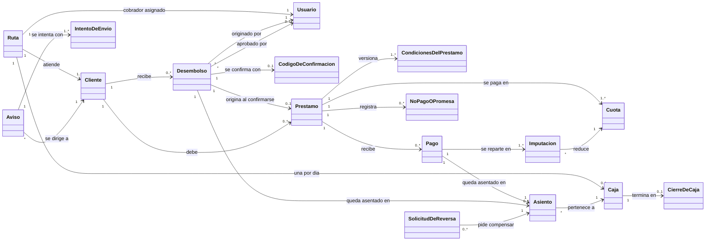
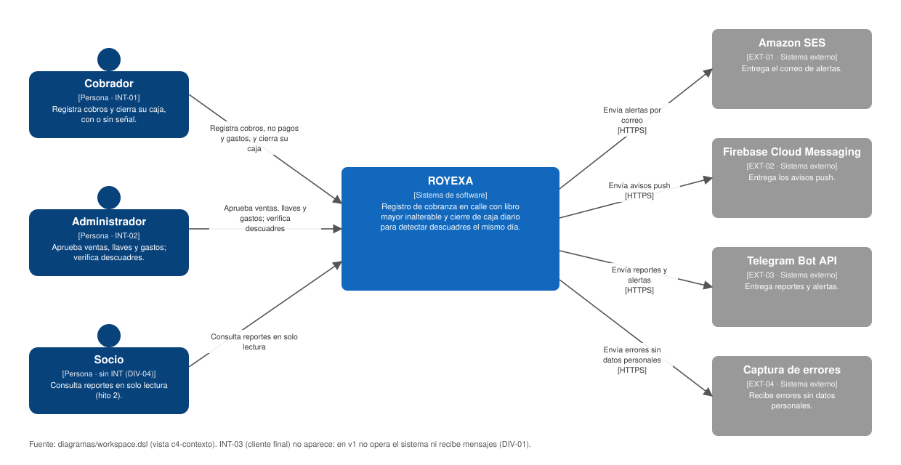
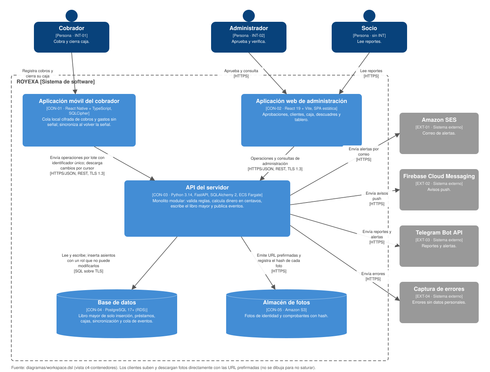

# Entrega 2 — Arquitectura candidata

## 0. Identificación

- **Proyecto:** ROYEXA
- **Integrantes:**
  - Julian Andres Restrepo
- **Grupo:** 10
- **Fecha:** 2026-09-20
- **Commit o etiqueta de entrega:** entrega-2-arquitectura
- **Versión entregada originalmente:** etiqueta `entrega-2-entregada` (`656cca1`)
- **Última realineación:** 2026-10-30, en [`realineacion-entrega-1.md`](realineacion-entrega-1.md)
- **Entrega 1 utilizada como línea base:** [`../01-requisitos/requisitos.md`](../01-requisitos/requisitos.md)

> **Fuente del estado del producto.** La Entrega 1 gobierna esta arquitectura y TRACKEA queda como referencia. El documento se creó el 2026-09-20 siguiendo a TRACKEA y el 2026-10-30 se realineó con la Entrega 1 sobre una demostración local de costo cero. El motivo, el alcance, la matriz de identificadores y la resolución de divergencias están en [`realineacion-entrega-1.md`](realineacion-entrega-1.md), y esa resolución está pendiente de confirmación docente. Las alternativas `ALT-XX`, sus comparaciones y la tabla `DIV-XX` se conservan como razonamiento histórico: se anotan, no se reescriben. Ningún `RF`, `RN`, `EC`, `ASR` ni `RES` de la Entrega 1 cambia de significado.

---

## 1. Modelo conceptual del dominio

### 1.1 Propósito y alcance del modelo

El modelo representa el dominio de la cobranza diaria en calle y de su control antifraude: quién presta, quién cobra, qué se debe, qué dinero se movió, en qué caja quedó y con qué autorización. Deja fuera las tablas, los servicios y el framework.

Permite responder cuatro preguntas que sostienen el propósito del producto:

1. ¿Qué movimientos de dinero existen, quién los ejecutó y cuándo, y puede alguien alterarlos después? (`RF-04`, `RN-04`)
2. ¿Cuánto debe un cliente y cuántas cuotas le quedan, sin errores de redondeo? (`RF-01`, `RN-01`)
3. ¿Cuánto efectivo debe entregar el cobrador al cierre y cuál es el descuadre? (`RF-02`, `RF-07`, `RN-02`)
4. ¿Qué operaciones sensibles necesitan la aprobación de alguien distinto de quien las originó? (`RF-03`, `RN-05`, `RN-06`)

Se relaciona con el recorrido vertical previsto en la Entrega 1, el desembolso de un préstamo (`RF-03`, `RF-04`, `RF-06`), que termina en el libro de movimientos. El recorrido del Bolt B1 de TRACKEA queda diferido (`DIV-06`).

### 1.2 Representación visual

Fuente editable: [`diagramas/modelo-conceptual.mmd`](diagramas/modelo-conceptual.mmd). Se muestra el mismo diagrama en texto reproducible (Mermaid):

### 1.3 Glosario del dominio

| Término | Definición contextual | Sinónimos o ambigüedades que deben evitarse | Referencias |
|---|---|---|---|
| Financiera | Empresa que presta y cobra. Se trabaja con una sola empresa, así que el término no tiene entidad propia en el modelo ni aislamiento asociado. | No confundir con *cliente*. TRACKEA la llama *tenant*. | `DIV-03` |
| Cliente | Persona que debe dinero a la financiera y a quien el cobrador visita. Es el deudor. No opera el sistema: recibe el código de confirmación y los comprobantes. | *Cliente final* (`INT-03`) en la Entrega 1. No es la financiera ni un usuario del sistema. | `INT-03`, `RES-04`, `RF-06`, `DIV-01` |
| Cobrador | Persona que recorre una ruta, cobra y cierra su caja. En TRACKEA cobrador y gestor son un solo rol. | *Gestor*, *agente de cobro*. | `INT-01`, `RF-01`, `RF-02` |
| Administrador | Usuario que aprueba o rechaza desembolsos y verifica cierres de caja. Nunca aprueba lo que originó, sin excepción. | *Supervisor*. Las plantillas principal y secundario de TRACKEA y el rol de socio quedan diferidos. | `INT-02`, `RN-06`, `EC-02`, `DIV-04`, `DIV-07` |
| Ruta | Recorrido de cobranza que une un cobrador y un conjunto de clientes. | *Zona*. | `RF-02` |
| Desembolso | Solicitud y entrega de un préstamo nuevo. Pasa por los estados solicitado, aprobado, rechazado, confirmado y caducado. | *Venta*, nombre usado en TRACKEA. El módulo `sales` conserva ese nombre heredado; el concepto es el desembolso de la Entrega 1. | `RF-03`, `RN-03`, `RN-05`, `DIV-01` |
| Código de confirmación | Código único, asociado a una operación y a un cliente, que caduca pasado su plazo. El cliente lo presenta y el cobrador lo valida. | *Llave* de TRACKEA, que aprobaba un administrador y caducaba por uso o cierre; no se usa en esta línea base. | `RN-03`, `CA-05`, `CA-06`, `DIV-01` |
| Préstamo | Deuda con interés fijo sobre el capital y cuota indivisible; sin cargo por mora ni descuento por pago anticipado. | *Crédito*. | `RF-05`, `RN-01` |
| Cuota | Parte de un préstamo con fecha de vencimiento en día de cobranza (lunes a sábado). No se descompone en interés y capital. | | `RN-01`, `CA-09` |
| Contador fraccionario | Número de cuotas restantes, que avanza de forma fraccionaria con los pagos parciales (25 sobre una cuota de 50 deja 19,5 de 20). | *Saldo en cuotas enteras*. | `RN-01`, `CA-01`, `EC-03` |
| Pago | Dinero recibido de un cliente, en efectivo o por transferencia, que se reparte entre las cuotas empezando por la más antigua. | *Cobro* es el acto del cobrador; *pago* es el registro. | `RF-01`, `RN-01`, `RES-01` |
| No pago | Visita sin cobro, con motivo y, opcionalmente, una promesa de pago. | | `RF-01`, `CA-02` |
| Caja | Registro del efectivo de una ruta en un día. Se abre y se cierra una sola vez y el cierre es irreversible. | *Arqueo*. | `RF-02`, `RN-02` |
| Descuadre | Diferencia con signo entre el efectivo declarado al cierre y el esperado. Cero no cuenta como descuadre. | | `RF-02`, `RF-07`, `CA-03` |
| Asiento | Registro inalterable de un movimiento de dinero, con importe, tipo, autor y dos marcas de tiempo (dispositivo y servidor). | *Movimiento* o *registro* en la Entrega 1; *ledger* y *libro mayor* en TRACKEA. Los tres nombres son el mismo concepto. | `RF-04`, `RN-04`, `CA-07` |
| Contra-asiento | Asiento que compensa a otro sin borrarlo. Es la única forma de corregir. | *Reversión*, *anulación* (sugieren borrado). | `RN-04`, `CA-08` |
| Operación de sincronización | Diferido. Instrucción registrada en el teléfono, con identificador único, que se enviaba al servidor al volver la señal. | | `DIV-02` |
| Aviso | Notificación al cliente final (código de confirmación o comprobante) emitida por el notificador simulado, con un estado consultable de cada intento de envío. | Los avisos a administradores y socios por correo, push o Telegram quedan diferidos. | `RF-06`, `EC-04`, `RES-03`, `RES-05`, `DIV-01` |

### 1.4 Conceptos principales

#### Asiento

- **Tipo conceptual:** Entidad.
- **Definición:** Hecho de dinero que quedó registrado: un pago, un desembolso, el intento caducado de un desembolso, un movimiento de caja o un contra-asiento.
- **Identidad o valor:** Identificador de asiento. Conserva la caja, el tipo, el importe, la hora informada por el dispositivo, la hora de recepción y quién lo ejecutó.
- **Ciclo de vida o estados:** No aplica. Un asiento nace confirmado y no cambia. Los estados de las solicitudes que lo originan viven en sus dueños (desembolso, reversa), no en el asiento.
- **Reglas e invariantes:** `RN-04`: solo se inserta; nunca se modifica ni se borra. Solo el módulo del libro mayor lo escribe.
- **Requisitos relacionados:** `RF-04`, `RF-02`.
- **Criterios relevantes:** `CA-07`, `CA-08`.
- **Relaciones principales:** Pertenece a una caja. Lo originan un pago o un desembolso. Una solicitud de reversa apunta a él.

#### Pago

- **Tipo conceptual:** Entidad.
- **Definición:** Dinero recibido de un cliente sobre un préstamo, en efectivo o por transferencia.
- **Identidad o valor:** Identificador de pago.
- **Ciclo de vida o estados:** Registrado. El estado «en revisión» dependía de la sincronización y queda diferido (`DIV-02`).
- **Reglas e invariantes:** `RN-01`: se imputa a las cuotas más antiguas primero y nunca excede el saldo. El dinero se representa en enteros de centavos, sin redondeo.
- **Requisitos relacionados:** `RF-01`.
- **Criterios relevantes:** `CA-01`, `CA-11`.
- **Relaciones principales:** Pertenece a un préstamo; se reparte en imputaciones sobre cuotas; genera un asiento.

#### Préstamo y cuota

- **Tipo conceptual:** Entidad con objetos de valor (condiciones versionadas).
- **Definición:** Deuda de un cliente, con su calendario de cuotas y las condiciones (tasa y valor de cuota) con las que se otorgó.
- **Identidad o valor:** Identificador de préstamo. Las condiciones son un valor versionado: la tasa y el número de cuotas no cambian tras el desembolso.
- **Ciclo de vida o estados:** Activo, moroso, pagado y castigado (ver 1.7). La mora es un estado, no un valor que crece.
- **Reglas e invariantes:** `RN-01`: sin interés ni cargo de mora. `RN-05`: renovar exige el préstamo anterior pagado al 100 %.
- **Requisitos relacionados:** `RF-05`.
- **Criterios relevantes:** `CA-09`, `CA-10`.
- **Relaciones principales:** Pertenece a un cliente; nace de un desembolso confirmado; tiene cuotas, pagos y no pagos.

#### Caja

- **Tipo conceptual:** Entidad.
- **Definición:** Efectivo de una ruta en un día, con tres paneles (clientes pendientes, que pagaron y que no pagaron) y distinción entre efectivo y transferencia.
- **Identidad o valor:** Una por ruta y día.
- **Ciclo de vida o estados:** Abierta o cerrada (ver 1.7).
- **Reglas e invariantes:** `RN-02`: solo se cierra sin clientes pendientes y el cierre es irreversible; un error posterior se corrige con un contra-asiento en la caja del día siguiente. El efectivo esperado es cobros en efectivo menos desembolsos confirmados; las transferencias no entran.
- **Requisitos relacionados:** `RF-02`, `RF-07`.
- **Criterios relevantes:** `CA-03`, `CA-04`, `CA-13`.
- **Relaciones principales:** Pertenece a una ruta; agrupa asientos; termina en un cierre con su descuadre.

#### Desembolso y código de confirmación

- **Tipo conceptual:** Entidad con ciclo de vida (desembolso) y objeto de valor de un solo uso con caducidad (código).
- **Definición:** El desembolso es la solicitud de un préstamo nuevo que un administrador debe aprobar y el cliente final confirmar antes de que salga el dinero. El código permite esa confirmación.
- **Identidad o valor:** Identificador de desembolso; el código queda asociado a esa operación y a ese cliente.
- **Ciclo de vida o estados:** Ver 1.7.
- **Reglas e invariantes:** `RN-03`: el dinero solo sale con el código vigente. `RN-05`: nuevo desembolso solo con préstamo liquidado, salvo excepción explícita. `RN-06`: quien originó no aprueba, sin excepción. Reconfirmar devuelve el resultado original (`INV-02`, `ADR-004`).
- **Requisitos relacionados:** `RF-03`, `RF-05`, `RF-06`.
- **Criterios relevantes:** `CA-05`, `CA-06`, `CA-10`.
- **Relaciones principales:** Lo solicita un usuario para un cliente; lo aprueba un usuario distinto; al confirmarse origina un préstamo; deja un asiento.

#### Operación de sincronización

> **Diferido (`DIV-02`).** Este concepto no forma parte de la línea base y salió del diagrama. Se conserva como registro de la Entrega 2.

- **Tipo conceptual:** Entidad.
- **Definición:** Instrucción del cobrador guardada en el teléfono mientras no había señal (un pago, un no pago, un gasto) y enviada después.
- **Identidad o valor:** Identificador de operación, único. Es la barrera contra duplicados.
- **Ciclo de vida o estados:** Recibida, aplicada, rechazada o en cuarentena (cuando se desvincula el dispositivo). El servidor decide y devuelve el resultado.
- **Reglas e invariantes:** Repetir el mismo identificador devuelve el resultado original y no vuelve a escribir. Cada operación y su efecto se confirman en una sola transacción. Ninguna `RN` de la Entrega 1 la cubre (`DIV-02`).
- **Requisitos relacionados:** `RF-01`, `RF-04`.
- **Criterios relevantes:** `CA-01`, `CA-07`.
- **Relaciones principales:** Produce un pago y su asiento.

#### Aviso

- **Tipo conceptual:** Entidad.
- **Definición:** Notificación al cliente final (código de confirmación o comprobante), emitida por el notificador simulado, con el estado de cada intento de envío.
- **Identidad o valor:** Identificador de aviso, con sus intentos de envío.
- **Ciclo de vida o estados:** Pendiente, enviado o fallido. Cada invocación del despachador cuenta un intento; tras 5 se marca fallido y queda consultable por el administrador.
- **Reglas e invariantes:** Un envío no confirmado nunca aparece como enviado. Un aviso perdido no invalida el dinero (`EC-04`). El asiento y el registro del aviso se confirman juntos.
- **Requisitos relacionados:** `RF-06`.
- **Criterios relevantes:** `CA-11` (pagos, Entrega 4), `CA-12`.
- **Relaciones principales:** Se origina en eventos de otros conceptos; tiene intentos de envío; se dirige a un cliente.

### 1.5 Relaciones y cardinalidades relevantes

| Origen | Relación | Destino | Cardinalidad | Justificación de dominio |
|---|---|---|---|---|
| Ruta | tiene asignado | Usuario (cobrador) | 1 a 1 | Una ruta tiene un cobrador (`RF-02`). |
| Ruta | abre | Caja | 1 a 0..* | Una caja por ruta y día (`RN-02`). |
| Cliente | recibe | Desembolso | 1 a 0..* | Un cliente puede tener varios desembolsos a lo largo del tiempo, uno por préstamo. |
| Desembolso | origina | Préstamo | 1 a 0..1 | Solo un desembolso confirmado crea un préstamo activo con su calendario (`RN-03`, `CA-05`). |
| Desembolso | queda asentado en | Asiento | 1 a 0..1 | La confirmación o la caducidad deja un solo asiento (`RN-03`, `RN-04`, `CA-06`). |
| Desembolso | originado por y aprobado por | Usuario | * a 1 y * a 0..1 | Quien originó no aprueba (`RN-06`). |
| Aviso | se dirige a | Cliente | * a 1 | El cliente final recibe el código y los comprobantes (`RF-06`). |
| Préstamo | se paga en | Cuota | 1 a 1..* | El calendario se deriva del monto, el plazo y el interés (`CA-09`). |
| Préstamo | recibe | Pago | 1 a 0..* | Un préstamo admite varios pagos parciales (`RN-01`). |
| Pago | se reparte en | Imputación | 1 a 1..* | Un pago mayor que la cuota avanza a las siguientes (`RN-01`). |
| Pago | queda asentado en | Asiento | 1 a 1 | Todo pago deja su asiento (`RN-04`, `CA-07`). |
| Asiento | pertenece a | Caja | * a 1 | Cada asiento se asigna a la caja de la ruta y el día (`RN-02`). |
| Solicitud de reversa | pide compensar | Asiento | 0..* a 1 | Corregir es agregar un contra-asiento (`RN-04`, `CA-08`). |
| Caja | termina en | Cierre | 1 a 0..1 | El cierre calcula el descuadre (`CA-03`). |

Las relaciones con Financiera, Dispositivo y Operación de sincronización salen del modelo vigente y quedan diferidas (`DIV-02`, `DIV-03`).

### 1.6 Reglas e invariantes representadas

| Regla o invariante | Conceptos involucrados | Límite de consistencia | Efecto sobre el modelo |
|---|---|---|---|
| `RN-01` Contador fraccionario | Pago, Imputación, Cuota, Préstamo | Un pago, sus imputaciones, su asiento y el contador se confirman juntos | El pago se reparte de la cuota más antigua a la más reciente; el contador avanza de forma fraccionaria; el dinero nunca es un decimal binario. |
| `RN-02` Cierre de caja | Caja, Cierre, Cliente | Una caja | Sin pendientes para cerrar; tras el cierre no se reabre ni se edita. |
| `RN-03` Liberación del dinero | Desembolso, Código de confirmación, Asiento | Un desembolso | El dinero solo sale con el desembolso aprobado y el código vigente. La caducidad no descuenta y deja un asiento del intento. |
| `RN-04` Solo inserción | Asiento, Solicitud de reversa | El libro de movimientos | Ningún asiento se modifica ni se borra; la corrección es un contra-asiento visible. |
| `RN-05` Renovación | Desembolso, Préstamo | Un cliente | Un desembolso nuevo exige el préstamo anterior liquidado, salvo excepción explícita. |
| `RN-06` Quien origina no aprueba | Desembolso, Usuario | Una solicitud | Quien originó no aprueba, sin excepción (`EC-02`, `DIV-07`). |
| `INV-01` El saldo lo calcula el servidor | Préstamo, Pago, Asiento | El servidor | Quien consume la API no fija saldos; los recibe. Derivada de `RN-01` y `RN-04`. |
| `INV-02` Una operación de dinero se asienta una sola vez | Desembolso, Asiento | Un desembolso y un tipo de asiento | Un reintento no duplica (`ADR-004`). Derivada de `RN-04` (nada se escribe dos veces). En la Entrega 2 se llamaba «identificador de operación único». |
| `INV-03` Aislamiento | Todas las entidades de negocio | La financiera | Diferida con `DIV-03`: se trabaja con una sola empresa. |

### 1.7 Estados y transiciones relevantes

| Concepto | Estado inicial | Evento o acción | Estado resultante | Precondición o regla |
|---|---|---|---|---|
| Desembolso | Solicitado | Un administrador distinto de quien lo originó lo aprueba | Aprobado | `RN-06`, `EC-02`. Se genera el código y se registra su envío. Un cobrador no puede aprobar. |
| Desembolso | Solicitado | Quien lo originó intenta aprobarlo | Solicitado | `RN-06`, `CA-06`. Se rechaza, no se genera código y queda la identidad de quien lo intentó. |
| Desembolso | Solicitado | Un administrador lo rechaza con motivo | Rechazado | Flujo principal de la Entrega 1, paso 4. |
| Desembolso | Aprobado | El cliente presenta el código vigente y el cobrador lo valida | Confirmado | `RN-03`, `CA-05`. Se asienta, se genera el calendario y se descuenta la caja en una transacción. Reconfirmar devuelve el resultado original (`ADR-004`). |
| Desembolso | Aprobado | Se intenta validar un código vencido | Caducado | `RN-03`, `CA-06`. No se descuenta dinero y queda un asiento del intento con su motivo. |
| Caja | Abierta | El cobrador cierra sin clientes pendientes | Cerrada | `RN-02`, `CA-03`. Con pendientes se rechaza (`CA-04`). |
| Caja | Cerrada | Cualquier intento de reabrirla o registrar un pago con su fecha | Cerrada | `RN-02`. La corrección va como contra-asiento en la caja siguiente. |
| Préstamo | Activo | La cuota impaga más antigua vence | Moroso | `RN-01`: sin cargo. El umbral de 3 días de TRACKEA queda diferido y seguía sin confirmarse. |
| Préstamo | Moroso | Un administrador lo marca con motivo | Castigado | Diferido: el castigo viene de TRACKEA y no está en la Entrega 1. |

### 1.8 Contextos delimitados preliminares

Los contextos son un vocabulario y una responsabilidad de negocio, no contenedores. Todos se ejecutan dentro del mismo servicio (ver `AD-02`); los módulos de la sección 4.2 se agrupan aquí por afinidad de negocio.

| Contexto preliminar | Responsabilidad de negocio | Conceptos principales | Relaciones con otros contextos |
|---|---|---|---|
| Identidad y acceso | Quién es cada usuario y qué puede hacer, con usuarios sembrados. | Ruta, Usuario | Todos los demás lo consultan para saber quién actúa. |
| Crédito | Quién debe qué y bajo qué condiciones; autorización de nuevos préstamos. | Cliente, Desembolso, Código de confirmación, Préstamo, Cuota | Consume identidad; alimenta cobranza. |
| Cobranza y dinero | Registrar el dinero, repartirlo y controlar la caja. | Pago, Imputación, Caja, Cierre, Asiento, Solicitud de reversa | Consume crédito; es la fuente de eventos para avisos. |
| Sincronización | Diferido (`DIV-02`). Recibía las operaciones sin señal. | Operación de sincronización | Sin relaciones en la línea base. |
| Avisos | Notificar al cliente final por el notificador simulado y dejar el estado consultable. Los reportes quedan diferidos. | Aviso, Intento de envío | Solo lee eventos; ningún otro contexto lo llama. |

### 1.9 Comprobación del modelo

#### Escenario principal

Se usa el flujo de la Entrega 1 (desembolso de un préstamo).

- **Entrada:** el cobrador registra por la API una solicitud de desembolso para un cliente de su ruta, con monto, plazo y número de cuotas.
- **Conceptos participantes:** Cobrador, Administrador, Cliente, Desembolso, Código de confirmación, Préstamo, Cuota, Asiento, Caja, Aviso.
- **Reglas activadas:** `RN-05` (el cliente no puede tener un préstamo anterior sin liquidar), `RN-06` (quien originó no aprueba), `RN-03` (el dinero sale con el código vigente), `RN-04`.
- **Estados modificados:** Desembolso: solicitado, aprobado y confirmado.
- **Resultado:** el préstamo queda activo con su calendario de cuotas, el desembolso queda asentado en el libro de movimientos con quién lo solicitó y quién lo aprobó, y el importe se descuenta del efectivo esperado de la caja.

#### Caso límite 1: reconfirmación del mismo código

- **Condición:** la confirmación llega al servidor, se corta la conexión antes de recibir la respuesta y el cobrador la repite.
- **Conceptos participantes:** Desembolso, Código de confirmación, Asiento, Caja.
- **Reglas o invariantes:** `RN-03`, `RN-04`, `INV-02`.
- **Respuesta esperada:** la repetición devuelve el resultado original. Existe un solo asiento y un solo descuento de caja (`ADR-004`, `EV-12`). El reintento de un lote sin señal queda diferido con `DIV-02`.

#### Caso límite 2: un administrador intenta aprobar el desembolso que originó

- **Condición:** un administrador registra una solicitud de desembolso y luego intenta aprobarla.
- **Conceptos participantes:** Desembolso, Usuario.
- **Reglas o invariantes:** `RN-06`, `EC-02`.
- **Respuesta esperada:** el sistema lo rechaza, no genera código y registra la identidad de quien lo intentó. No existe excepción para ningún administrador (`DIV-07`).

#### Caso límite 3: el código caduca sin confirmación

- **Condición:** el desembolso está aprobado y el plazo del código ya venció.
- **Conceptos participantes:** Desembolso, Código de confirmación, Asiento, Caja.
- **Reglas o invariantes:** `RN-03`, `RN-04`, `CA-06`.
- **Respuesta esperada:** se rechaza la confirmación, no se descuenta dinero y queda un asiento del intento con su motivo. El pago sin señal sobre un préstamo ya pagado queda diferido con `DIV-02`.

### 1.10 Preguntas abiertas del modelo

- Resuelta, pendiente de confirmación docente: la arquitectura vuelve al alcance original (`DIV-02`, `DIV-03`).
- Resuelta, pendiente de confirmación docente: el cliente final (`INT-03`) se mantiene como destinatario, con notificador simulado (`DIV-01`).
- Resuelta, pendiente de confirmación docente: `RN-06` no admite excepción (`DIV-07`).
- Diferida: los umbrales de mora de 3 días y de divergencia de reloj de 24 horas seguían sin confirmar y quedan fuera de la línea base.
- Resuelta: el docente autorizó el trabajo individual (`DIV-08`).

---

## 2. Asuntos de decisión arquitectónica

### 2.1 Inventario inicial

| ID | Asunto formulado como pregunta neutral | Origen | Interesados afectados | Importancia y costo de cambio | Estado |
|---|---|---|---|---|---|
| AD-01 | ¿Cómo garantizar que un movimiento de dinero, una vez confirmado, no pueda alterarse ni borrarse, incluso si el código de la aplicación falla? | `ASR-01`, `EC-01`, `RN-04`, `RF-04` | `INT-01`, `INT-02` | Es la razón de ser del producto. Cambiarlo con datos reales obliga a migrar el historial del libro. | Analizado (`ADR-001`) |
| AD-02 | ¿Cómo organizar y comunicar las partes del sistema para que el dinero se confirme de forma atómica y un fallo en los avisos no lo invalide ni pase inadvertido? | `ASR-01`, `ASR-02`, `ASR-05`, `EC-04`, `RES-02`, `RES-03`, `RES-05`, `RES-06` | `INT-01`, `INT-02` | Fija la unidad de despliegue y las fronteras internas; es muy costoso de deshacer una vez que hay código. | Analizado (`ADR-002`) |
| AD-03 | ¿Cómo asegurar que una operación de dinero confirmada por el cobrador llegue al libro una sola vez, sin duplicarse ni perderse? | `ASR-01`, `ASR-02`, `RF-03`, `RF-04`, `RN-03`, `RN-04`, `EC-01`; `DIV-02` | `INT-01`, `INT-02` | Un reintento HTTP podría duplicar un asiento y un descuento de caja, y el libro no admite correcciones que borren. | Analizado (`ADR-004`, propuesto). La formulación de la Entrega 2, sobre cobros sin señal, se conserva en la sección 3.3. |
| AD-04 | ¿Cómo evitar que los datos de una financiera sean visibles para otra sobre una misma instalación? | `DIV-03`; `RES-04` | `INT-02` | Un fallo expone datos personales y financieros de terceros. Cambiarlo después obliga a rehacer el esquema. | Diferido con `DIV-03`. Se trabaja con una sola empresa. |
| AD-05 | ¿Cómo representar y calcular importes y cuotas sin error de redondeo acumulado? | `ASR-04`, `EC-03`, `RN-01` | `INT-01`, `INT-02` | El error se acumula cuota a cuota y la caja deja de cuadrar. | Decisión heredada, sin análisis comparativo: enteros de centavos y funciones puras. Se valida con `EV-10`. |
| AD-06 | ¿Cómo hacer cumplir en el servidor, y no solo en la interfaz, que quien origina una operación no la aprueba? | `ASR-03`, `EC-02`, `RN-06` | `INT-02` | Un hueco aquí habilita el fraude que el producto combate. | Analizado en la sección 3.4 (`ALT-06B`), sin ADR propio. |
| AD-07 | ¿Cómo hacer que el resultado de cada envío de aviso quede registrado y consultable? | `ASR-05`, `EC-04`, `RF-06` | `INT-02` | Un aviso perdido sin estado rompe el control en silencio. | Cubierto dentro de `AD-02`. |

### 2.2 Priorización

Se analizan en profundidad `AD-01`, `AD-02` y `AD-03` por tres razones. Primero, cada uno nace de un `ASR` de la Entrega 1. Segundo, son las decisiones más caras de cambiar una vez que hay datos y código. Tercero, los tres se ejercitan en el primer recorrido vertical: `AD-01` con el libro de movimientos, `AD-02` con la confirmación atómica y los avisos, `AD-03` con la reconfirmación del código del desembolso.

`AD-06` se compara en la sección 3.4, como prometía la trazabilidad de la Entrega 2. `AD-05` se deja en el inventario como decisión heredada que necesita evidencia (`EV-10`). `AD-04` se difiere con `DIV-03` y conserva su identificador. `AD-07` se resuelve como consecuencia de `AD-02`.

---

## 3. Evaluación de alternativas arquitectónicas

> **Nota de lectura (2026-10-30).** Las alternativas y las comparaciones conservan el razonamiento y el vocabulario de la Entrega 2 (venta, llave, PIX, teléfono, módulos de TRACKEA). Las anotaciones fechadas indican qué cambió. Lo vigente son las decisiones provisionales de `AD-01`, `AD-02` y `AD-06`, y `ADR-004` para `AD-03`.

### 3.1 AD-01 — Inalterabilidad del libro de movimientos

#### Asunto de decisión

> ¿Cómo garantizar que un movimiento de dinero, una vez confirmado, no pueda alterarse ni borrarse, incluso si el código de la aplicación falla?

#### Contexto y trazabilidad

- **ASR relacionados:** `ASR-01`
- **Requisitos funcionales:** `RF-04`, `RF-02`, `RF-03`
- **Reglas o invariantes:** `RN-04`, `INV-02`
- **Escenarios de calidad:** `EC-01`
- **Restricciones:** `RES-04`, `RES-02`, `RES-06`
- **Interesados afectados:** `INT-01`, `INT-02`
- **Riesgos iniciales:** `RA-01`, `RA-02`

#### Criterios de evaluación

##### Obligatorios

- **O1.** El rechazo de una modificación o un borrado debe ocurrir aunque el código de la aplicación tenga un defecto o reciba una consulta manipulada (`EC-01`: el 100 % de los intentos se rechaza).
- **O2.** La corrección de un error debe dejar visibles el asiento original y el compensatorio (`RN-04`).
- **O3.** El asiento y su efecto sobre el pago, el saldo y la caja deben confirmarse juntos o no confirmarse.

##### Prioritarios

- **P1.** Verificable con una prueba automatizada repetible (forma de verificación de `EC-01`).
- **P2.** Operable por un equipo mínimo (`RES-02`; `DIV-08`).
- **P3.** Costo cero: sin servicios de pago (`RES-06`). La Entrega 2 usaba como referencia el presupuesto de infraestructura de TRACKEA, unos 185 a 195 USD al mes.

##### Deseables

- **D1.** Que la manipulación por parte de quien tenga acceso privilegiado a la base de datos deje evidencia.

#### ALT-01A — Inalterabilidad por convención en la aplicación

- **Descripción:** El código no ofrece operaciones de actualizar ni borrar sobre el libro. La tabla admite `UPDATE` y `DELETE` al rol que usa la aplicación.
- **Supuestos:** Todo acceso a la tabla pasa por el código de la aplicación y este no tiene defectos.
- **Beneficios:** Sin configuración adicional de la base de datos. La más simple de construir.
- **Costos o sacrificios:** La garantía vive solo en el código y no puede demostrarse a alguien que desconfíe de él.
- **Riesgos:** Un defecto, una consulta cruda o una inyección de SQL alteran el pasado sin que nada lo impida (`RA-01`).
- **Puntos sensibles:** Los privilegios efectivos del rol de la aplicación.
- **Elementos arquitectónicos afectados:** `CON-03`, `CON-04`.
- **Evidencia disponible:** Ninguna.
- **Evidencia necesaria:** `EV-01`.

#### ALT-01B — Solo inserción garantizada por privilegios de la base de datos y un único módulo escritor

- **Descripción:** El rol de la aplicación solo tiene `INSERT` y `SELECT` sobre el libro; se le retiran explícitamente `UPDATE`, `DELETE` y `TRUNCATE`. Un rol distinto ejecuta las migraciones. Un solo módulo (el libro mayor) escribe la tabla y los demás le piden los asientos. Las correcciones son contra-asientos y el saldo es la suma de los asientos. Los estados de las solicitudes (venta, gasto, reversa) viven en sus módulos dueños, no en el libro.
- **Supuestos:** `SUP-01`.
- **Beneficios:** El rechazo lo hace la base de datos, aunque el código falle. La garantía se demuestra con una prueba automatizada que intenta alterar el libro con el rol de la aplicación.
- **Costos o sacrificios:** Los privilegios deben mantenerse correctos en cada migración. Cada operación de dinero pasa por una llamada más. Un dato derivado mutable (el efectivo esperado de la caja) debe actualizarse en la misma transacción.
- **Riesgos:** Una migración con una concesión demasiado amplia anula la garantía (`RA-01`). Quien tenga el rol propietario puede alterar el libro (`RA-02`).
- **Puntos sensibles:** El conjunto de privilegios sobre el libro. La redacción anterior citaba también un registro de cambios que el esquema no tiene (`HV-02`).
- **Elementos arquitectónicos afectados:** `CON-03`, `CON-04`.
- **Evidencia disponible:** Ninguna en este repositorio. TRACKEA contiene una migración con el libro y una prueba de aceptación, sin resultado de ejecución registrado; se toman como referencia, no como evidencia.
- **Evidencia necesaria:** `EV-01`, `EV-02`.

#### ALT-01C — Cadena de hashes sobre los asientos

- **Descripción:** Cada asiento guarda un valor calculado a partir del anterior y un proceso periódico verifica la cadena. La tabla admite modificaciones pero cualquier cambio rompe la cadena.
- **Supuestos:** Es posible serializar el cálculo de la cadena por caja sin degradar el registro de cobros concurrentes.
- **Beneficios:** Detecta la manipulación incluso de quien tenga acceso privilegiado.
- **Costos o sacrificios:** Detecta, no impide. Añade un cálculo serializado a cada inserción y un proceso de verificación que operar.
- **Riesgos:** La alteración puede tardar en detectarse hasta la siguiente verificación. Puede degradar el rendimiento del cobro.
- **Puntos sensibles:** La concurrencia de escrituras sobre una misma caja.
- **Elementos arquitectónicos afectados:** `CON-03`, `CON-04`.
- **Evidencia disponible:** Ninguna.
- **Evidencia necesaria:** Medir el costo de la cadena bajo cobros concurrentes (no planificada).

#### Comparación

| Criterio | Tipo | ALT-01A | ALT-01B | ALT-01C | Observaciones y evidencia faltante |
|---|---|---|---|---|---|
| O1 Rechazo aunque falle el código | Obligatorio | No cumple | Cumple bajo una condición | No cumple | En 01B, si los privilegios se mantienen en cada migración (`EV-02`). 01C no impide el cambio, lo detecta. |
| O2 Corrección visible | Obligatorio | Cumple | Cumple | Cumple | Las tres usan contra-asientos. |
| O3 Confirmación conjunta | Obligatorio | Cumple | Cumple | Requiere evidencia | En 01C la cadena añade un paso serializado a la misma transacción. |
| P1 Prueba automatizada | Prioritario | Introduce un riesgo | Cumple | Requiere evidencia | En 01A la prueba solo demostraría que el código no ofrece la operación. |
| P2 Operable por un equipo mínimo | Prioritario | Cumple | Cumple bajo una condición | Introduce un riesgo | 01B exige disciplina en las migraciones; 01C añade un proceso periódico. |
| P3 Sin costo adicional | Prioritario | Cumple | Cumple | Cumple | Ninguna añade servicios de pago. El resultado se mantiene bajo `RES-06`. |
| D1 Evidencia frente a privilegiados | Deseable | No cumple | No cumple | Cumple | Solo 01C. Puede añadirse después sobre 01B. |

#### Decisión provisional

> **Anotación (2026-10-31).** `EV-01` y `EV-02` quedaron `Validada` y `ADR-001` pasó a `Aceptado`, con los límites que declara ese registro (`HV-01`, `HV-03`, `HV-07`).

- **Alternativa seleccionada:** ALT-01B.
- **Justificación:** Es la única que cumple el criterio obligatorio de rechazo aunque falle el código y que permite demostrarlo con una prueba automatizada, que es la forma de verificación de `EC-01`. TRACKEA, que queda como referencia, tomó la misma decisión (rol de la aplicación sin actualización ni borrado, roles separados y libro con un solo escritor). PostgreSQL local es obligatorio para `EV-01` y `EV-02`: un libro en memoria equivale a ALT-01A.
- **Alternativas descartadas:** ALT-01A por incumplir el criterio obligatorio. ALT-01C como decisión principal porque detecta pero no impide y añade costo de concurrencia; se conserva como refuerzo posible (ver condiciones de revisión).
- **Consecuencias positivas:** La garantía antifraude tiene un solo lugar donde probarse. Un defecto de código no puede alterar el pasado.
- **Consecuencias negativas aceptadas:** Cada operación de dinero pasa por una llamada más. Los privilegios exigen una prueba de ausencia en cada migración. El propietario de la base sigue pudiendo alterar el libro.
- **Riesgos pendientes:** `RA-01`, `RA-02`.
- **Supuestos pendientes:** `SUP-01`.
- **Evidencia por obtener:** `EV-01`, `EV-02`.
- **Condiciones de revisión:** Si `EV-02` encuentra privilegios de más que no pueden mantenerse de forma estable, o si un requisito exige detectar la manipulación por privilegiados, se añade ALT-01C.
- **ADR correspondiente:** [`ADR-001`](adr/ADR-001-libro-de-movimientos-de-solo-insercion.md)

---

### 3.2 AD-02 — Organización y comunicación de las partes del sistema

#### Asunto de decisión

> ¿Cómo organizar y comunicar las partes del sistema para que el dinero se confirme de forma atómica y un fallo en los avisos no lo invalide ni pase inadvertido?

#### Contexto y trazabilidad

- **ASR relacionados:** `ASR-01`, `ASR-02`, `ASR-05`
- **Requisitos funcionales:** `RF-01`, `RF-03`, `RF-04`, `RF-06`
- **Reglas o invariantes:** `RN-04`, `RN-06`
- **Escenarios de calidad:** `EC-01`, `EC-04`
- **Restricciones:** `RES-02`, `RES-03`, `RES-05`, `RES-06`
- **Interesados afectados:** `INT-01`, `INT-02`
- **Riesgos iniciales:** `RA-03`, `RA-04`

#### Criterios de evaluación

##### Obligatorios

- **O1.** Un pago, su asiento, su imputación y el efecto sobre la caja se confirman en una sola transacción (`RN-04`, `ASR-01`).
- **O2.** El fallo de un canal de aviso no revierte ni bloquea la operación de dinero, y el envío no confirmado queda visible como fallido o pendiente (`EC-04`, `ASR-05`).
- **O3.** Debe poder ejecutarse en un entorno local para las pruebas (`RES-02`).

##### Prioritarios

- **P1.** Fronteras claras con un dueño único por cada regla de negocio.
- **P2.** Operable y mantenible por un equipo mínimo (`RES-02`; `DIV-08`).
- **P3.** Costo cero (`RES-06`). La Entrega 2 usaba como referencia el presupuesto de TRACKEA, unos 185 a 195 USD al mes.
- **P4.** Los canales de aviso son reemplazables sin tocar la lógica de negocio (`RES-03`).

##### Deseables

- **D1.** Que una parte pueda separarse después sin reescribir las demás.

#### ALT-02A — Monolito modular con llamadas directas para lo atómico y eventos por una cola en la base de datos solo hacia avisos y reportes

- **Descripción:** Un solo servicio desplegable dividido en módulos por regla de negocio. Los módulos se llaman dentro del proceso cuando la operación debe ser atómica. Los eventos pasan por una cola definida como puerto: una bandeja de salida en PostgreSQL, escrita en la misma transacción que el dinero, y un adaptador en memoria para las pruebas. Un despachador invocable la vacía, sin trabajador en segundo plano. Solo el módulo de avisos consume esos eventos y ningún módulo de negocio lo llama.
- **Supuestos:** `SUP-03` (diferido con el despliegue en la nube).
- **Beneficios:** Conserva la atomicidad del dinero. Los productores no conocen a los consumidores. Un solo despliegue y una sola base de datos que operar.
- **Costos o sacrificios:** Más carpetas y fronteras que mantener con un solo desarrollador. Un evento perdido deja al cliente final sin código o comprobante, aunque no afecta al dinero.
- **Riesgos:** `RA-03`, `RA-04`.
- **Puntos sensibles:** El grafo de dependencias entre módulos y el tamaño de la transacción.
- **Elementos arquitectónicos afectados:** `CON-03`, `CON-04`, `EXT-05`. `EXT-01`, `EXT-02` y `EXT-03` quedan diferidos.
- **Evidencia disponible:** Ninguna en este repositorio. Los módulos de TRACKEA se toman como referencia, no como evidencia.
- **Evidencia necesaria:** `EV-03`, `EV-08`, `EV-09`. `EV-04` queda reprogramada.

#### ALT-02B — Servicios independientes por dominio con mensajería asíncrona

- **Descripción:** El dinero, la sincronización y los avisos son servicios separados que se comunican por un intermediario de mensajes. Cada uno tiene su almacenamiento.
- **Supuestos:** Existe capacidad para operar varios servicios, un intermediario de mensajes y trazado distribuido.
- **Beneficios:** Escalado y despliegue independientes. Aislamiento de fallos por servicio.
- **Costos o sacrificios:** El pago y su asiento cruzarían servicios, así que la atomicidad exigiría coordinación distribuida. Más piezas que operar y más costo de infraestructura.
- **Riesgos:** Un asiento confirmado sin el efecto correspondiente si la coordinación falla (rompe `RN-04`).
- **Puntos sensibles:** La consistencia entre el pago y el asiento.
- **Elementos arquitectónicos afectados:** Todos los contenedores; introduce un intermediario de mensajes.
- **Evidencia disponible:** Ninguna.
- **Evidencia necesaria:** Prototipo de la coordinación (no planificado).

#### ALT-02C — Monolito con llamadas directas para todo, incluidos los avisos, dentro de la misma transacción

- **Descripción:** Un solo servicio. Confirmar un pago envía el aviso en el mismo flujo, sin cola de eventos.
- **Supuestos:** Los canales de aviso responden siempre y rápido.
- **Beneficios:** La más simple. El estado del aviso se conoce al instante.
- **Costos o sacrificios:** Cada módulo de negocio conoce a los canales. El tablero se recalcularía por cada operación.
- **Riesgos:** Un canal caído bloquea o revierte el cobro; o, si se ignora el error, el envío falla en silencio (rompe `EC-04`).
- **Puntos sensibles:** El tiempo de respuesta de los canales externos.
- **Elementos arquitectónicos afectados:** `CON-03`, `EXT-01`, `EXT-02`, `EXT-03`.
- **Evidencia disponible:** Ninguna.
- **Evidencia necesaria:** `EV-03`.

#### Comparación

| Criterio | Tipo | ALT-02A | ALT-02B | ALT-02C | Observaciones y evidencia faltante |
|---|---|---|---|---|---|
| O1 Confirmación atómica del dinero | Obligatorio | Cumple | Introduce un riesgo | Cumple | 02B requiere coordinación distribuida. |
| O2 Fallo de aviso sin invalidar el dinero y visible | Obligatorio | Cumple bajo una condición | Cumple bajo una condición | No cumple | 02A: si los reintentos y el estado fallido funcionan (`EV-03`). |
| O3 Ejecutable en local | Obligatorio | Cumple | Requiere evidencia | Cumple | 02B exige levantar varios servicios y un intermediario. |
| P1 Dueño único por regla | Prioritario | Cumple | Cumple | Introduce un riesgo | En 02C todos los módulos conocen los canales. |
| P2 Operable por un equipo mínimo | Prioritario | Cumple bajo una condición | No cumple | Cumple | 02A exige cuidar las fronteras (`RA-04`). |
| P3 Costo contenido | Prioritario | Cumple | No cumple | Cumple | 02B añade servicios y un intermediario. Anotación: la comparación usó el presupuesto de TRACKEA; bajo `RES-06` el resultado se mantiene y 02A cumple con PostgreSQL local. |
| P4 Canales reemplazables | Prioritario | Cumple | Cumple | Introduce un riesgo | En 02A y 02B el canal es un adaptador; ver `EV-08`. |
| D1 Separación posterior | Deseable | Cumple | Cumple | No cumple | 02A conserva fronteras que permiten separar después. |

#### Decisión provisional

> **Anotación (2026-10-31).** `EV-03` y `EV-09` quedaron `Validada`. `EV-08` sigue prevista para la Entrega 4, así que `ADR-002` sigue `Propuesto` (`HV-05`, `HV-06`, `HV-07`).

- **Alternativa seleccionada:** ALT-02A.
- **Justificación:** Es la única que cumple a la vez la atomicidad del dinero (O1) y la independencia del aviso respecto del dinero (O2) con la capacidad de un equipo mínimo y costo cero (`RES-06`). TRACKEA queda como referencia.
- **Alternativas descartadas:** ALT-02B por incumplir P2 y P3 y por poner en riesgo O1. ALT-02C por incumplir O2.
- **Consecuencias positivas:** El dinero se confirma de forma atómica. Los productores no conocen a los consumidores. El grafo de módulos es acíclico.
- **Consecuencias negativas aceptadas:** Más fronteras internas que mantener. La cola de eventos comparte la base de datos con el dominio.
- **Riesgos pendientes:** `RA-03`, `RA-04`.
- **Supuestos pendientes:** Ninguno vigente; `SUP-03` queda diferido.
- **Evidencia por obtener:** `EV-03`, `EV-08`, `EV-09`. `EV-04` queda reprogramada.
- **Condiciones de revisión:** Si `EV-09` detecta ciclos que no pueden eliminarse, o si el despachador invocable no basta para demostrar `EV-03`. La revisión por tiempos con dos tareas y por volumen solo aplica si se retoma `EV-04`.
- **ADR correspondiente:** [`ADR-002`](adr/ADR-002-monolito-modular-con-eventos-para-avisos.md)

---

### 3.3 AD-03 — Cobros sin señal que llegan una sola vez

> **Anotación (2026-10-30).** Esta sección se conserva como razonamiento histórico. [`ADR-004`](adr/ADR-004-operacion-en-linea-con-confirmacion-idempotente.md) selecciona `ALT-03A` con confirmación idempotente, porque `O2` y `O3` nacían de `DIV-02` y no de la Entrega 1. El criterio que descartó `ALT-03A` no se reescribe aquí: `ADR-004` declara por qué cae. `ADR-003` pasa a `Reemplazado por ADR-004` solo con la confirmación docente.

#### Asunto de decisión

> ¿Cómo asegurar que un cobro registrado sin señal llegue una sola vez, sin duplicarse ni perderse?

#### Contexto y trazabilidad

- **ASR relacionados:** `ASR-01`
- **Requisitos funcionales:** `RF-01`, `RF-04`
- **Reglas o invariantes:** `RN-04`, `RN-01`, `INV-02`
- **Escenarios de calidad:** `EC-01`, `EC-03`
- **Restricciones:** `RES-04`; y `DIV-02` respecto del alcance de la Entrega 1
- **Interesados afectados:** `INT-01`, `INT-02`
- **Riesgos iniciales:** `RA-05`, `RA-06`, `RA-07`

#### Criterios de evaluación

##### Obligatorios

- **O1.** Un cobro registrado no puede duplicarse ni perderse (integridad de `ASR-01`; requisito de integridad de TRACKEA).
- **O2.** El cobrador debe poder registrar un cobro cuando no hay señal, y ese registro debe quedar firme (interesado 1 de la propuesta).
- **O3.** Los datos guardados en el teléfono deben estar cifrados (`RES-04`).

##### Prioritarios

- **P1.** Los reintentos ante cortes son seguros.
- **P2.** El servidor decide el resultado y lo explica al cobrador (por ejemplo, un pago sobre un préstamo ya pagado).
- **P3.** Complejidad asumible por un desarrollador sin experiencia móvil previa.

##### Deseables

- **D1.** Bajo consumo de datos: la jornada de un cobrador cabe en menos de 1 minuto de conexión 4G.

#### ALT-03A — Aplicación solo en línea

- **Descripción:** El cobro se registra directamente en el servidor. Sin señal, el cobrador anota en papel y registra después.
- **Supuestos:** La ruta tiene señal suficiente durante la jornada.
- **Beneficios:** Sin cola local, sin sincronización y sin duplicados posibles. Es el alcance de la Entrega 1 (interfaz web).
- **Anotación (2026-10-30):** «sin duplicados posibles» es falso ante un reintento HTTP. `ADR-004` añade la confirmación idempotente y `EV-12`.
- **Costos o sacrificios:** El registro depende de la señal. El papel reintroduce el hueco de «cobrar y no registrar».
- **Riesgos:** El cobrador no puede demostrar de inmediato lo cobrado, que es la preocupación de `INT-01`.
- **Puntos sensibles:** El porcentaje de la jornada sin señal.
- **Elementos arquitectónicos afectados:** `CON-02` como única interfaz de registro; sin `CON-01`.
- **Evidencia disponible:** Ninguna.
- **Evidencia necesaria:** Medir la proporción de visitas sin señal en la ruta piloto (no planificada).

#### ALT-03B — Cola local cifrada, lotes con identificador único de operación y descarga incremental por cursor

- **Descripción:** El teléfono guarda cada operación en una base local cifrada con un identificador único. Al volver la señal envía lotes de hasta 100 operaciones. El servidor usa el identificador como barrera de idempotencia: repetir el identificador devuelve el resultado original. Ordena las operaciones por préstamo, guarda el resultado y publica los cambios que el teléfono descarga por cursor.
- **Supuestos:** `SUP-04`, `SUP-05`.
- **Beneficios:** El cobro queda firme en el teléfono aunque no haya señal. Los reintentos son seguros. El servidor conserva la decisión.
- **Costos o sacrificios:** El teléfono concentra el riesgo técnico: base cifrada, cola, reintentos y pantallas. Hay que definir qué acciones no se permiten sin señal (una venta nueva, pedir una llave o cerrar la caja).
- **Riesgos:** `RA-05`, `RA-06`, `RA-07`.
- **Puntos sensibles:** El tamaño del lote, el número de sentencias por operación y el nivel de seguridad del almacén de claves del teléfono.
- **Elementos arquitectónicos afectados:** `CON-01`, `CON-03`, `CON-04`.
- **Evidencia disponible:** Ninguna en este repositorio. TRACKEA contiene pruebas de integración del servidor sobre el reintento del mismo identificador, sin aplicación móvil; se toman como referencia, no como evidencia.
- **Evidencia necesaria:** `EV-05`, `EV-06`.

#### ALT-03C — Réplica local con sincronización bidireccional y fusión automática

- **Descripción:** El teléfono guarda una copia de las entidades y ambas partes reconcilian los cambios con una regla automática (por ejemplo, gana la última escritura).
- **Supuestos:** Los conflictos pueden resolverse sin intervención humana.
- **Beneficios:** El cobrador ve y edita datos con más libertad sin señal.
- **Costos o sacrificios:** Una regla de «gana la última escritura» puede sobrescribir dinero. Contradice el libro de solo inserción (`RN-04`).
- **Riesgos:** Un pago perdido o alterado por la fusión.
- **Puntos sensibles:** La regla de resolución de conflictos.
- **Elementos arquitectónicos afectados:** `CON-01`, `CON-03`, `CON-04`.
- **Evidencia disponible:** Ninguna.
- **Evidencia necesaria:** Ninguna prevista: se descarta por incumplir O1.

#### Comparación

| Criterio | Tipo | ALT-03A | ALT-03B | ALT-03C | Observaciones y evidencia faltante |
|---|---|---|---|---|---|
| O1 Ni duplicado ni perdido | Obligatorio | Cumple bajo una condición | Cumple bajo una condición | No cumple | 03A depende de que el registro en papel se transcriba; 03B, de `EV-05`. |
| O2 Registro firme sin señal | Obligatorio | No cumple | Cumple bajo una condición | Cumple | 03B: si el teléfono cumple `EV-06`. |
| O3 Datos locales cifrados | Obligatorio | Cumple | Requiere evidencia | Requiere evidencia | En 03B depende de la biblioteca de cifrado y del almacén de claves (`RA-06`). |
| P1 Reintentos seguros | Prioritario | Cumple | Cumple | Introduce un riesgo | En 03B por el identificador único. |
| P2 El servidor explica el resultado | Prioritario | Cumple | Cumple | No cumple | En 03C la fusión oculta la decisión. |
| P3 Complejidad asumible | Prioritario | Cumple | Introduce un riesgo | No cumple | 03B concentra el riesgo declarado en TRACKEA (`RA-06`). |
| D1 Bajo consumo de datos | Deseable | Cumple | Cumple | Requiere evidencia | |

#### Decisión provisional

> **Anotación (2026-10-30).** Decisión histórica de la Entrega 2. La decisión vigente propuesta para `AD-03` está en `ADR-004`.

- **Alternativa seleccionada:** ALT-03B.
- **Justificación:** Es la única que cumple el criterio de registro firme sin señal (O2) y mantiene la integridad (O1) con el servidor como autoridad. Coincide con la decisión ya tomada en TRACKEA. **Esta decisión depende de `DIV-02`:** la Entrega 1 excluye la operación sin conexión. Si el docente confirma esa exclusión, la decisión debe revisarse hacia ALT-03A.
- **Alternativas descartadas:** ALT-03A porque deja el registro sujeto a la señal, que es el problema de `INT-01`. ALT-03C porque puede sobrescribir dinero y contradice `RN-04`.
- **Consecuencias positivas:** El cobro queda firme en el teléfono. Los reintentos no duplican. El servidor conserva la decisión y la explica.
- **Consecuencias negativas aceptadas:** Riesgo técnico concentrado en el teléfono. Acciones deshabilitadas sin señal. Un contrato de sincronización que debe versionarse.
- **Riesgos pendientes:** `RA-05`, `RA-06`, `RA-07`.
- **Supuestos pendientes:** `SUP-04`, `SUP-05`.
- **Evidencia por obtener:** `EV-05`, `EV-06`.
- **Condiciones de revisión:** Si `DIV-02` se resuelve excluyendo la operación sin conexión; si el cifrado local no supera la verificación previa en el Android de referencia; si la proporción de visitas sin señal resulta baja.
- **ADR correspondiente:** [`ADR-003`](adr/ADR-003-sincronizacion-idempotente-por-identificador-de-operacion.md)

---

### 3.4 AD-06 — Autorización en el servidor

#### Asunto de decisión

> ¿Cómo hacer cumplir en el servidor, y no solo en la interfaz, que quien origina una operación no la aprueba?

#### Contexto y trazabilidad

- **ASR relacionados:** `ASR-03`
- **Requisitos funcionales:** `RF-03`
- **Reglas o invariantes:** `RN-06`
- **Escenarios de calidad:** `EC-02`
- **Restricciones:** `RES-02`, `RES-06`
- **Interesados afectados:** `INT-02`
- **Riesgos iniciales:** Sin riesgo registrado en 6.1. La identidad de usuarios sembrados es una limitación declarada.

#### Criterios de evaluación

##### Obligatorios

- **O1.** El 100 % de las autoaprobaciones se rechaza en el servidor, sea cual sea la entrada usada (`EC-02`).
- **O2.** Un intento rechazado no genera código y deja registrada la identidad de quien lo intentó (`RN-06`, `CA-06`).

##### Prioritarios

- **P1.** Verificable con una prueba automatizada sobre la interfaz de entrada del sistema (forma de verificación de `EC-02`).
- **P2.** La regla tiene un dueño único y no depende del framework (`ASR-03`).
- **P3.** Operable por un equipo mínimo y con costo cero (`RES-02`, `RES-06`).

##### Deseables

- **D1.** Que la política pueda extenderse a otras operaciones sin reescribir los casos de uso.

#### ALT-06A — Comprobación en la interfaz o en el controlador

- **Descripción:** Cada punto de entrada compara al usuario autenticado con quien originó la solicitud antes de invocar el caso de uso.
- **Supuestos:** Toda aprobación pasa por un punto de entrada que aplica la comprobación.
- **Beneficios:** La más simple de construir.
- **Costos o sacrificios:** La regla se repite por cada entrada: la API de la Entrega 3 y la web de la Entrega 4.
- **Riesgos:** Una entrada nueva que omita la comprobación habilita la autoaprobación.
- **Puntos sensibles:** El número de puntos de entrada.
- **Elementos arquitectónicos afectados:** `CON-02`, `CON-03`.
- **Evidencia disponible:** Ninguna.
- **Evidencia necesaria:** `EV-11`.

#### ALT-06B — Regla en el dominio y rol en la entrada

- **Descripción:** El agregado aplica la regla: `Desembolso.aprobar(actor)` rechaza al actor que originó la solicitud y deja el intento registrado. La entrada verifica el rol y entrega el actor al caso de uso. Los usuarios se siembran en la base de datos, sin gestión de cuentas.
- **Supuestos:** La identidad del actor que llega al dominio es fiable en una demostración local con usuarios sembrados.
- **Beneficios:** Ninguna entrada puede evitar la regla. Se prueba sin framework y también sobre la API.
- **Costos o sacrificios:** El actor debe llegar hasta el dominio. La autorización queda en dos lugares: el rol en la entrada y la regla en el agregado.
- **Riesgos:** Con usuarios sembrados, la identidad no tiene el respaldo de una gestión real de cuentas.
- **Puntos sensibles:** El dato de quién originó la solicitud, que no debe poder modificarse.
- **Elementos arquitectónicos afectados:** `CON-03`.
- **Evidencia disponible:** Ninguna.
- **Evidencia necesaria:** `EV-11`.

#### ALT-06C — Motor externo de políticas

- **Descripción:** Una política declarativa, evaluada por un motor externo al dominio, autoriza cada aprobación.
- **Supuestos:** Habrá suficientes políticas para justificar una pieza dedicada.
- **Beneficios:** Políticas centralizadas y fáciles de auditar.
- **Costos o sacrificios:** Una pieza más que aprender y ejecutar, para una sola regla. El motor necesita datos del desembolso.
- **Riesgos:** La regla central del antifraude queda fuera del dominio.
- **Puntos sensibles:** La sincronización entre la política y los datos que evalúa.
- **Elementos arquitectónicos afectados:** `CON-03`; introduce un componente de políticas.
- **Evidencia disponible:** Ninguna.
- **Evidencia necesaria:** Prototipo del motor (no planificado).

#### Comparación

| Criterio | Tipo | ALT-06A | ALT-06B | ALT-06C | Observaciones y evidencia faltante |
|---|---|---|---|---|---|
| O1 Rechazo en el servidor | Obligatorio | Introduce un riesgo | Cumple | Cumple bajo una condición | 06A depende de cada entrada. 06C, de que toda aprobación consulte el motor. `EV-11` lo verifica en 06B. |
| O2 Intento registrado y sin código | Obligatorio | Requiere evidencia | Cumple | Requiere evidencia | En 06B el rechazo y su registro ocurren en el mismo lugar. |
| P1 Prueba sobre la entrada | Prioritario | Cumple | Cumple | Cumple | |
| P2 Dueño único de la regla | Prioritario | No cumple | Cumple | Introduce un riesgo | En 06A la regla se repite; en 06C vive fuera del dominio. |
| P3 Equipo mínimo y costo cero | Prioritario | Cumple | Cumple | Introduce un riesgo | 06C añade una pieza que operar. |
| D1 Extensible a otras operaciones | Deseable | No cumple | Cumple bajo una condición | Cumple | 06B exige aplicar la regla en cada agregado. |

#### Decisión provisional

- **Alternativa seleccionada:** ALT-06B.
- **Justificación:** Es la única que cumple los dos criterios obligatorios sin depender de cada punto de entrada, y mantiene la regla en un solo dueño. `EV-11` la verifica sobre la API, que es la forma de verificación de `EC-02`.
- **Alternativas descartadas:** ALT-06A por repetir la regla y dejar el rechazo sujeto a cada entrada. ALT-06C porque añade una pieza para una sola regla.
- **Consecuencias positivas:** La web de la Entrega 4 hereda la regla sin reimplementarla. La regla se prueba sin framework.
- **Consecuencias negativas aceptadas:** Los usuarios sembrados son una limitación declarada: no hay registro, recuperación ni gestión de cuentas. El rol y la regla se verifican en lugares distintos.
- **Riesgos pendientes:** Ninguno registrado en 6.1.
- **Supuestos pendientes:** Fiabilidad de la identidad con usuarios sembrados, limitada a la demostración local.
- **Evidencia por obtener:** `EV-11`.
- **Condiciones de revisión:** Si se incorpora gestión real de usuarios, o si más operaciones necesitan aprobación y la regla empieza a repetirse entre agregados.
- **ADR correspondiente:** No aplica. `AD-06` no tiene ADR propio; `EV-11` se registra en `ADR-002`, que incluye `RN-06` en su trazabilidad.

---

## 4. Consolidación de la arquitectura candidata

### 4.1 Síntesis

Las tres decisiones forman una sola idea: el dinero solo se escribe en un lugar, una vez y sin posibilidad de alteración, y todo lo demás se organiza alrededor de esa garantía.

- `AD-01` fija que el libro de movimientos solo admite inserciones y que lo garantiza la base de datos, no la disciplina del código.
- `AD-03` fija cómo una operación de dinero llega a ese libro una sola vez: se registra en línea y la confirmación del código es idempotente, de modo que repetirla devuelve el resultado original sin volver a asentar (`ADR-004`).
- `AD-02` fija dónde vive la lógica y cómo se comunican las partes: un solo servicio, dividido en módulos con dueños claros, donde el dinero se confirma en una transacción y los avisos salen por eventos, de modo que un fallo de aviso no toca el dinero pero queda registrado.

`AD-05` y `AD-06` refuerzan esa idea: los importes son enteros de centavos y la regla de que quien origina no aprueba vive en el dominio. `AD-04` queda diferida con `DIV-03`.

### 4.2 Organización general

- **Sistema objeto de estudio:** ROYEXA, registro de cobranza en calle con libro mayor inalterable y cierre de caja diario.
- **Unidad o unidades de ejecución:** la API del servidor (`CON-03`, FastAPI con Uvicorn en local), único proceso de la Entrega 3; y, en la Entrega 4 (provisional), la web mínima renderizada en el servidor (`CON-02`), que corre en local y llama a la API. `CON-01` queda diferido. Todos los módulos del servidor forman parte de `CON-03`.
- **Almacenamientos:** PostgreSQL 17 local (`CON-04`), con el libro, los préstamos, las cajas y la bandeja de salida de eventos. Es obligatorio para demostrar el libro (`EV-01`, `EV-02`). Los adaptadores en memoria sirven para las pruebas que no dependen de esa garantía. `CON-05` queda diferido.
- **Almacenamiento en la Entrega 3 (2026-10-31):** solo el libro está en `CON-04`. Desembolsos, préstamos, cajas y bandeja de salida viven en memoria también en ejecución, y se pierden al reiniciar (`HV-07`, `RA-10`).
- **Fronteras externas:** el notificador simulado (`EXT-05`). `EXT-01` a `EXT-04` quedan diferidos.
- **Responsabilidades principales:** en el servidor, módulos con dueño único de sus entidades: `identity_access` (mínimo, con usuarios sembrados), `clients`, `loans`, `sales` (dueño del desembolso; conserva el nombre heredado), `ledger`, `cash_box` y `notifications`. Quedan diferidos `tenancy`, `devices`, `consent`, `sync`, `expenses`, `reporting` y `payments`, que vuelve en la Entrega 4 (provisional).
- **Dirección de las dependencias:** el grafo de módulos es acíclico. Los módulos de dinero dependen de identidad y de clientes; `ledger` depende de `cash_box` para asignar cada asiento a una caja; solo `notifications` lee eventos y ningún módulo de negocio lo llama. Las aplicaciones cliente dependen de la API, nunca de la base de datos.
- **Mecanismos generales de comunicación:** REST descrita con OpenAPI, versionada en la ruta (`/v1`), con errores en el formato estándar de detalles de problema; llamadas directas dentro del proceso para lo atómico; y eventos por un puerto con bandeja de salida y despachador invocable.

**Retirado (2026-10-30).** El estado observado en TRACKEA ya no describe esta arquitectura. Se conserva en la etiqueta `entrega-2-entregada`.

### 4.3 Relación con el recorrido vertical

**Recorrido previsto en la Entrega 1 (desembolso de un préstamo)**

- **Entrada del recorrido:** solicitud de desembolso del cobrador, con monto, plazo y número de cuotas.
- **Contenedor que recibe la entrada:** `CON-03`, directamente por la API. La Entrega 3 no tiene interfaz.
- **Responsabilidad principal:** validar que el cliente no tenga un préstamo sin liquidar, impedir que quien originó apruebe, generar el código, confirmar o caducar el desembolso y asentarlo.
- **Reglas protegidas:** `RN-03`, `RN-04`, `RN-05`, `RN-06`.
- **Persistencia prevista:** `CON-04`.
- **Integración externa:** `EXT-05`, notificador simulado del código y del comprobante al cliente final (`RES-03`, `RES-05`).
- **Resultado observable:** desembolso confirmado con calendario de cuotas y descuento en caja, o intento caducado sin descuento de dinero y con asiento del motivo.

**Recorrido que ejercitaba el Bolt B1 (diferido con `DIV-06`)**

No forma parte de la línea base. Se conserva como registro de la Entrega 2.

- **Entrada del recorrido:** un cobro en efectivo registrado en el teléfono sin señal.
- **Contenedor que recibe la entrada:** `CON-01` (guarda la operación) y `CON-03` (la recibe al volver la señal).
- **Responsabilidad principal:** aplicar la operación una sola vez, imputarla, asentarla y asignarla a la caja.
- **Reglas protegidas:** `RN-01`, `RN-04`, `INV-02`, `INV-03`.
- **Persistencia prevista:** `CON-04`.
- **Integración externa:** No aplica en B1.
- **Resultado observable:** el cobro aparece en el libro del entorno de pruebas una sola vez y el teléfono ve el saldo actualizado.

### 4.4 Decisiones que conforman la arquitectura

| Decisión | Contribución a la arquitectura | Elementos afectados | ADR |
|---|---|---|---|
| AD-01 | El libro solo admite inserciones por privilegios de la base de datos y tiene un único módulo escritor. | `CON-03`, `CON-04` | ADR-001 |
| AD-02 | Un servicio único con módulos por regla de negocio, llamadas directas para lo atómico y eventos hacia avisos. | `CON-02`, `CON-03`, `CON-04`, `EXT-05` | ADR-002 |
| AD-03 | Operación en línea con confirmación idempotente: máquina de estados del desembolso y unicidad del asiento por desembolso y tipo. | `CON-02`, `CON-03`, `CON-04` | ADR-004 (propuesto; ADR-003 no cambia de estado hasta la confirmación docente) |
| AD-06 | Regla en el dominio y rol en la entrada, con usuarios sembrados como limitación declarada. | `CON-03` | Sin ADR propio (sección 3.4) |

### 4.5 Decisiones diferidas

| Asunto pendiente | Razón para diferirlo | Momento o evidencia necesaria |
|---|---|---|
| AD-04 Aislamiento entre financieras | Fuera de la línea base: se trabaja con una sola empresa (`DIV-03`). | `EV-07`, reprogramada sin destino en el curso |
| AD-05 Representación del dinero | Decisión heredada; falta la comparación de alternativas. | `EV-10`; Entrega 4 |
| AD-06 Autorización en el servidor | Ya no está diferida: se compara en la sección 3.4. | `EV-11`; Entrega 3 |
| Canal real de aviso | Fuera de la línea base: el notificador es simulado (`RES-03`). | Sin destino en el curso |
| Trabajador de eventos en segundo plano | La línea base usa un despachador invocable. | Solo si el recorrido lo exige |
| Proveedor real de notificación al cliente final | Excluido por la Entrega 1 (`RES-03`). La comunicación se simula con `EXT-05`. | Sin destino en el curso |
| Almacén de fotos | Fuera de la línea base (`CON-05`). | Sin destino en el curso |
| Escalado y puertas de rendimiento | Fuera de la línea base: la demostración es local. | `EV-04`, reprogramada sin destino en el curso |

---

## 5. Vistas C4

### 5.1 Fuente del modelo

- **Archivo Structurizr DSL:** [`diagramas/workspace.dsl`](diagramas/workspace.dsl)
- **Exportaciones:** [`diagramas/c4-contexto.svg`](diagramas/c4-contexto.svg) y [`diagramas/c4-contenedores.svg`](diagramas/c4-contenedores.svg). **Pendientes de reexportar:** se dibujaron a mano a partir del DSL de la Entrega 2 y todavía muestran ese modelo. Deben generarse desde el `workspace.dsl` realineado. Ver la nota en 7.

### 5.2 C4 de Contexto, nivel 1

#### Explicación

- **Sistema representado:** ROYEXA, como una sola unidad.
- **Personas:** el cobrador (`INT-01`), el administrador (`INT-02`) y el cliente final (`INT-03`), que no opera el sistema: recibe el código y los comprobantes por el notificador simulado (`DIV-01`). El socio sigue en el modelo con la etiqueta `Diferido`, fuera de las vistas (`DIV-04`).
- **Sistemas externos:** el notificador simulado (`EXT-05`; `ASR-05`, `AD-02`, `RES-03`, `RES-05`). `EXT-01` a `EXT-04` siguen en el modelo con la etiqueta `Diferido`, fuera de las vistas.
- **Límite del sistema:** todo lo que se construye y se ejecuta en local: la web mínima, la API y la base de datos. El notificador simulado queda fuera porque es una frontera con contrato y fallo explícito.
- **Relaciones principales:** el cobrador solicita desembolsos, valida el código, registra pagos y cierra su caja; el administrador aprueba o rechaza y verifica; el sistema notifica al cliente final a través del notificador simulado.

### 5.3 C4 de Contenedores, nivel 2

#### Catálogo de contenedores

| ID | Contenedor | Responsabilidad | Tecnología candidata | Decisiones relacionadas |
|---|---|---|---|---|
| CON-01 | Aplicación móvil del cobrador (diferido, `DIV-02`) | Registrar cobros, no pagos y gastos sin señal en una cola local cifrada y sincronizar al volver la señal. | Candidata de la Entrega 2: React Native, TypeScript, SQLCipher; Android 10 o superior | ADR-003 |
| CON-02 | Aplicación web mínima | Permitir al cobrador y al administrador operar desembolsos, pagos y cierre de caja. No existe en la Entrega 3; se construye en la Entrega 4 (provisional). | Plantillas renderizadas en el servidor, en local | AD-02, AD-03, ADR-002, ADR-004 |
| CON-03 | API del servidor | Validar las reglas de negocio, calcular el dinero en centavos, escribir el libro mayor y registrar eventos para avisos. | Python 3.14, FastAPI, Uvicorn local | AD-01, AD-02, AD-03, AD-06, ADR-001, ADR-002, ADR-004 |
| CON-04 | Base de datos | Conservar el libro de solo inserción, préstamos, cajas y la bandeja de salida de eventos. | PostgreSQL 17 local; adaptadores en memoria para las pruebas | AD-01, AD-02, AD-03, ADR-001, ADR-002, ADR-004 |
| CON-05 | Almacén de fotos (diferido) | Guardar fotos de documento, residencia, comercio y comprobantes de gasto, con verificación de hash. | Candidata de la Entrega 2: Amazon S3 | Sin decisión |

#### Coherencia entre vistas

La vista de componentes de `CON-03` se añadió al mismo `workspace.dsl` con la clave `c4-componentes` y se explica en [`../03-diseno-vertical/diseno-y-vertical.md`](../03-diseno-vertical/diseno-y-vertical.md), sección 2.

El sistema que el diagrama de Contexto muestra como una unidad se descompone en `CON-02`, `CON-03` y `CON-04`. `CON-01` y `CON-05` siguen en el modelo con la etiqueta `Diferido` y no aparecen en las vistas. El cobrador y el administrador usan la API directamente en la Entrega 3 y `CON-02` en la Entrega 4. `EXT-05` se relaciona con `CON-03`, único contenedor que lo invoca, y entrega al cliente final. No aparecen capas, paquetes ni módulos: los módulos del servidor están dentro de `CON-03` y no son contenedores, porque se ejecutan juntos.

---

## 6. Riesgos, supuestos, puntos sensibles y evidencia pendiente

### 6.1 Riesgos arquitectónicos

| ID | Riesgo | Origen | Probabilidad | Impacto | Acción inicial | Estado |
|---|---|---|---|---|---|---|
| RA-01 | Una migración concede privilegios de más sobre el libro y anula la garantía de solo inserción. | AD-01, ALT-01B | Media | Alto | Revocar de forma explícita tras cada concesión y probar la ausencia de los privilegios en cada migración (`EV-02`). | Abierto |
| RA-02 | Quien tenga el rol propietario de la base o el de migraciones puede alterar el libro. | AD-01, ALT-01B | Baja | Alto | Roles separados y credenciales de migración fuera de la configuración de la aplicación. Evaluar ALT-01C como refuerzo. | Abierto |
| RA-03 | Un evento perdido deja al cliente final sin código o comprobante. | AD-02, ALT-02A | Media | Medio | Bandeja de salida en la misma transacción; cada invocación del despachador cuenta un intento y tras 5 el envío queda fallido y consultable (`EV-03`). | Abierto |
| RA-04 | Las fronteras entre los módulos de la línea base se erosionan y aparecen ciclos. | AD-02, ALT-02A | Media | Medio | Mantener el grafo acíclico y probarlo de forma automática (`EV-09`). | Abierto |
| RA-05 | La resolución del ciclo entre pagos y sincronización (por el identificador de operación) agrega una dependencia del dinero hacia la sincronización. | AD-03, ALT-03B | Media | Medio | Tratar el identificador como valor opaco de idempotencia propio de pagos (`EV-05`). | Cerrado: no hay sincronización en la línea base. |
| RA-06 | La aplicación móvil concentra el riesgo técnico: cifrado local, Android 10 de gama baja y un desarrollador sin experiencia móvil. | AD-03, ALT-03B | Alta | Alto | Verificar primero el cifrado y la licencia en el aparato de referencia; si falla, plan B con lista cerrada de campos sensibles (`EV-06`). | Cerrado: no hay aplicación móvil en la línea base. |
| RA-07 | La operación sin conexión no está en el alcance de la Entrega 1 y la trazabilidad podría no aceptarse. | AD-03, `DIV-02` | Media | Alto | Discutir `DIV-02` con el docente antes de la evaluación. | Cierra con la resolución de `DIV-02`, pendiente de confirmación docente. |
| RA-08 | En v1 no existe un comprobante independiente hacia el cliente final, así que el control frente al prestatario que la Entrega 1 considera no negociable (`RES-05`) queda sin cubrir. | `ASR-02`, `ASR-05`, `DIV-01` | Alta | Alto | Registrar en `DIV-01`; decidir con el docente si se difiere o se reincorpora. | Cierra con la resolución de `DIV-01`, pendiente de confirmación docente. |
| RA-09 | Un cobro llega con la hora del teléfono muy distinta de la del servidor y cae en la caja equivocada. | `RN-02`, AD-03 | Media | Medio | Regla de umbral de 24 horas con alerta (pendiente de confirmar con el cliente). | Diferido con `DIV-02`. |
| RA-10 | El libro y los datos en memoria no comparten una transacción. Una caída entre los dos pasos del `commit`, o un reinicio, deja asientos en `CON-04` sin su desembolso ni su efecto en la caja. | AD-02, ALT-02A, `HV-07` | Media | Alto | Limitarlo a la demostración local, declararlo y llevar desembolsos, cajas y bandeja de salida a `CON-04` en la misma transacción que el libro. | Abierto |
| RA-11 | La entrega de avisos es de al menos una vez. Un fallo al confirmar tras enviar repite el aviso, y una excepción distinta de `NotifierUnavailable` corta la ejecución del despachador. | AD-02, ALT-02A, `HV-06` | Media | Medio | Tratar cualquier fallo del adaptador como un intento fallido y dar al adaptador real un identificador de mensaje para descartar duplicados. | Abierto |

### 6.2 Supuestos

| ID | Supuesto | Decisión relacionada | Consecuencia si es falso | Forma de validación | Estado |
|---|---|---|---|---|---|
| SUP-01 | PostgreSQL 17 local permite roles separados y retirar privilegios de forma explícita. | AD-01 / ADR-001 | El libro no puede protegerse por privilegios y hay que volver a una alternativa con más control en la aplicación. | `EV-01`, `EV-02` | Confirmado por `EV-01` y `EV-02` sobre PostgreSQL 17.11 (`HV-01`). |
| SUP-02 | Los administradores usan Telegram (aún no confirmado con el cliente). | AD-02 / ADR-002 | Hay que cambiar el canal de reportes; la arquitectura no cambia porque el canal es un adaptador. | `EV-08` | Diferido: el notificador es simulado. |
| SUP-03 | Un servicio con dos tareas cubre unos 2.000 clientes con los tiempos objetivo (lote de sincronización en 500 ms, cierre de caja en 300 ms, tablero en 1 s). | AD-02 / ADR-002 | Se reconsidera la separación de módulos o el dimensionamiento. | `EV-04` | Diferido: la demostración es local. |
| SUP-04 | La jornada de un cobrador cabe en menos de 1 minuto de conexión 4G con lotes de hasta 100 operaciones. | AD-03 / ADR-003 | Hay que rediseñar el tamaño de lote o la descarga. | `EV-05` | Diferido con `DIV-02`. |
| SUP-05 | El cobrador usa un teléfono Android 10 o superior suministrado por la financiera. | AD-03 / ADR-003 | La cola cifrada debe soportar aparatos que no controla la financiera. | `EV-06` | Diferido con `DIV-02`. |

### 6.3 Puntos sensibles

| Elemento o propiedad | Variación considerada | Atributo o requisito afectado | Efecto esperado | Evidencia requerida | Estado |
|---|---|---|---|---|---|
| Privilegios del rol de la aplicación sobre el libro | Se añade `UPDATE` o `TRUNCATE` por una migración | `EC-01`, `ASR-01` | El libro deja de ser inalterable. | `EV-01`, `EV-02` | Vigente |
| Tamaño del lote y sentencias por operación | Un lote pasa de 100 a más operaciones o cada operación hace más consultas | Tiempo de respuesta de la sincronización | Se supera el objetivo de 500 ms. | `EV-04` | Diferido |
| Valor con el que se fija el contexto de la financiera en la transacción | Se construye con una cadena manipulable | Aislamiento entre financieras (`DIV-03`) | Una sola inyección anula el aislamiento. | `EV-07` | Diferido |
| Umbral de divergencia de reloj | Cambia de 24 horas a otro valor | `RN-02` | Cambia en qué caja cae un cobro tardío. | Sin evidencia definida: el umbral está pendiente de confirmar con el cliente. | Diferido |
| Nivel de seguridad del almacén de claves del teléfono | En un aparato de gama de entrada el almacén puede ser solo de software | Cifrado local, `RES-04` | La clave podría extraerse en un aparato comprometido. | `EV-06` | Diferido |
| Restricción de unicidad del asiento por desembolso y tipo | Una migración la retira o la amplía | `RN-04`, `ASR-01` | Una reconfirmación concurrente duplica el asiento. | `EV-12` | Vigente |

### 6.4 Evidencia pendiente

| ID | Pregunta que debe responder | Actividad de validación | Resultado esperado | Momento previsto |
|---|---|---|---|---|
| EV-01 | ¿El rol de la aplicación puede alterar el libro? | Ejecutar la prueba de aceptación que intenta `UPDATE`, `DELETE` y `TRUNCATE` sobre un asiento con el rol de la aplicación y consulta después la fila. | El 100 % de los intentos falla con error de permiso y la fila queda intacta. | Entrega 3 |
| EV-02 | ¿Tras aplicar todas las migraciones el rol de la aplicación carece de esos privilegios? | Consultar el catálogo de privilegios de la base de datos y afirmar la ausencia de modificar, borrar y vaciar sobre el libro, y que el rol de la aplicación y `PUBLIC` no tienen concesiones sobre otra tabla. | Ausencia de los tres privilegios, comprobada en cada ejecución de `uv run pytest -m postgres`. | Entrega 3 |
| EV-03 | ¿Un fallo del notificador invalida el dinero o pasa inadvertido? | Sustituir el notificador simulado por un adaptador que falla al notificar el código de un desembolso e invocar el despachador. | El desembolso y el dinero se conservan; cada invocación cuenta un intento y tras 5 el envío queda fallido y consultable por el administrador. | Entrega 3 |
| EV-04 | ¿Se cumplen los tiempos objetivo con dos tareas? | Medir el percentil 95 del lote de sincronización, del cierre de caja y del tablero contra el entorno de pruebas con unos 1,5 millones de asientos. | 500 ms, 300 ms y 1 s respectivamente. | Reprogramada, sin destino en el curso |
| EV-05 | ¿Un reintento duplica el cobro? | Enviar el mismo identificador desde el mismo dispositivo y desde otro, un lote de 101 y una falla a mitad de la transacción. | Un solo pago y un solo asiento; el reintento devuelve el resultado original. | Reprogramada, sin destino en el curso |
| EV-06 | ¿El cobro sin señal funciona de extremo a extremo en un Android 10 real? | Registrar un cobro sin señal en el aparato de referencia y devolver la señal. | El cobro aparece una sola vez en el libro del entorno de pruebas y el teléfono ve el saldo actualizado; se registra el nivel del almacén de claves. | Reprogramada, sin destino en el curso |
| EV-07 | ¿Una financiera puede ver datos de otra? | Ejecutar la prueba de fuga entre dos financieras generada desde el contrato OpenAPI en cada integración. | Cero filas de otra financiera en todas las rutas. | Reprogramada, sin destino en el curso |
| EV-08 | ¿El notificador es realmente reemplazable? | Cambiar el adaptador del notificador y registrar los módulos afectados. | Solo cambia el adaptador. | Entrega 4 |
| EV-09 | ¿Los módulos respetan el grafo acíclico y ninguno de negocio llama a avisos? | Prueba estática de dependencias entre módulos. | Cero ciclos y cero llamadas prohibidas. | Entrega 3 |
| EV-10 | ¿El cálculo de un pago parcial es exacto y repetible? | Ejecutar las pruebas del cálculo de imputación con pago parcial, exacto y excedente (por ejemplo, 25 sobre una cuota de 50 en un préstamo de 20 cuotas) y una prueba de propiedad sobre la suma de las imputaciones. | 19,5 cuotas restantes de 20, sin diferencia de redondeo, en el 100 % de las repeticiones. | Reprogramada a Entrega 4 |
| EV-11 | ¿La autoaprobación se rechaza en el servidor? | Prueba automatizada del flujo de aprobación de un desembolso sobre la API, con el administrador que lo originó y con un cobrador. | Se rechazan todas las autoaprobaciones, sin generar código y con la identidad registrada. | Entrega 3 |
| EV-12 | ¿Reconfirmar el código duplica el asiento? | Repetir por HTTP la confirmación de un desembolso ya confirmado y lanzar dos confirmaciones concurrentes del mismo código. | Un solo asiento y un solo descuento de caja; todas las respuestas devuelven el resultado original. | Entrega 3 |

**Alcance de las evidencias frente al recorrido vertical**

- `EV-10` y `CA-11` tratan de pagos, fuera del recorrido de desembolso, y pasan a la Entrega 4 (provisional).
- `CA-12` sí entra, porque cubre el fallo al notificar un código de confirmación.
- `CA-07` se redacta sobre un pago, pero sus campos se exigen al asiento del desembolso y deben aparecer en la traza.
- El resultado de cada evidencia está en [`../03-diseno-vertical/diseno-y-vertical.md`](../03-diseno-vertical/diseno-y-vertical.md), sección 8. Esta tabla conserva lo que se pidió comprobar.

---

## 7. Registro de cambios y observaciones

| Fecha | Cambio | Motivo | Artefactos afectados | Responsable |
|---|---|---|---|---|
| 2026-09-20 | Creación de la arquitectura candidata a partir del estado de TRACKEA | Sincronizar la documentación con el producto | `arquitectura.md`, `trazabilidad-arquitectonica.md`, `adr/ADR-001` a `ADR-003`, `diagramas/workspace.dsl`, `diagramas/c4-contexto.svg`, `diagramas/c4-contenedores.svg`, `diagramas/modelo-conceptual.mmd` | Julian Andres Restrepo |
| 2026-09-20 | Los SVG de C4 se dibujaron a mano a partir del DSL | No se pudo ejecutar Structurizr en el entorno de trabajo (Docker no estaba activo) | `diagramas/c4-contexto.svg`, `diagramas/c4-contenedores.svg` | Julian Andres Restrepo |
| 2026-09-20 | Se dejó como único integrante a Julian Andres Restrepo | Indicación de la sincronización | `README.md`, `docs/00-propuesta/propuesta.md`, `docs/01-requisitos/requisitos.md`, `arquitectura.md` | Julian Andres Restrepo |
| 2026-10-30 | Realineación con la Entrega 1: la Entrega 1 gobierna y TRACKEA queda como referencia | Pérdida de financiamiento del producto y demostración local de costo cero (`RES-06`) | `realineacion-entrega-1.md`, `arquitectura.md`, `trazabilidad-arquitectonica.md`, `adr/ADR-001`, `adr/ADR-002`, `adr/ADR-004`, `diagramas/workspace.dsl`, `diagramas/modelo-conceptual.mmd` | Julian Andres Restrepo |
| 2026-10-30 | Comparación de `AD-06` en la sección 3.4; se selecciona `ALT-06B` | La trazabilidad de la Entrega 2 la había diferido a la Entrega 3 | `arquitectura.md`, `trazabilidad-arquitectonica.md` | Julian Andres Restrepo |
| 2026-10-30 | Columna «Resolución» y `DIV-08` en 7.1; estado de `RA`, `SUP` y puntos sensibles; `EV-12` y `EXT-05` nuevos; evidencias reprogramadas | Registrar la línea base sin borrar identificadores | `arquitectura.md`, `realineacion-entrega-1.md` | Julian Andres Restrepo |
| 2026-10-30 | Se corrigió la afirmación «La Entrega 1 no se modificó» | El commit `5077046` editó los integrantes en `propuesta.md` y `requisitos.md` | `arquitectura.md` | Julian Andres Restrepo |
| 2026-10-31 | `EV-02` deja de citar el registro de cambios, que no existe en el esquema, y nombra el comando que la ejecuta | El recorrido vertical no lo implementa y la evidencia no podía comprobarse como estaba escrita (`HV-02`) | `arquitectura.md`, `adr/ADR-001` | Julian Andres Restrepo |
| 2026-10-31 | `ADR-001` pasa a `Aceptado`; `ADR-002` y `ADR-004` se ajustan y siguen `Propuesto`; `SUP-01` confirmado; `RA-10` y `RA-11` nuevos; vista `c4-componentes` añadida al DSL | Resultado de la Entrega 3 (`HV-01` a `HV-09`) | `arquitectura.md`, `adr/ADR-001`, `adr/ADR-002`, `adr/ADR-004`, `diagramas/workspace.dsl`, `realineacion-entrega-1.md` | Julian Andres Restrepo |
| 2026-10-31 | `EV-03` pasa a `Validada`; la cobertura de ASR y las columnas de evidencia de la trazabilidad muestran el resultado de la Entrega 3 | Se añadió la prueba que faltaba (`HV-05`) y la matriz seguía indicando evidencia pendiente | `arquitectura.md`, `trazabilidad-arquitectonica.md`, `realineacion-entrega-1.md`, `adr/ADR-002` | Julian Andres Restrepo |
| 2026-10-31 | `DIV-08` queda resuelta: el docente autorizó el trabajo individual | Confirmación del autor; el repositorio no guarda la constancia de esa autorización | `arquitectura.md`, `realineacion-entrega-1.md`, `docs/03-diseno-vertical/diseno-y-vertical.md` | Julian Andres Restrepo |

**Pendiente antes de entregar:** validar `workspace.dsl` con Structurizr, que tampoco ha procesado la vista `c4-componentes`, y sustituir los SVG por su exportación oficial; los SVG actuales todavía muestran el modelo de la Entrega 2. El archivo [`adr/ADR-00X-titulo-de-la-decision.md`](adr/ADR-00X-titulo-de-la-decision.md) es la plantilla y se conserva sin cambios.

### 7.1 Divergencias entre la Entrega 1 y TRACKEA

El significado de la Entrega 1 no cambió, pero su texto sí: el commit `5077046` editó los integrantes en `propuesta.md` y `requisitos.md`, lo que se registra en `DIV-08`. Cada divergencia se registró para discutirla con el docente, como pide el enunciado de esta entrega. En la Entrega 2 la arquitectura seguía a TRACKEA; la columna «Resolución» indica el criterio vigente desde el 2026-10-30. Las resoluciones de `DIV-01` a `DIV-07` están pendientes de confirmación docente.

| ID | Entrega 1 | TRACKEA (2026-09-20) | Efecto en esta entrega | Resolución |
|---|---|---|---|---|
| DIV-01 | `RF-03`, `RN-03`, `CA-05`, `CA-06`: el cliente final confirma el desembolso con un código con caducidad. `RF-06`, `CA-11`, `CA-12`, `EC-04`, `RES-03`, `RES-05`: el cliente final recibe un comprobante de cada pago. | El cliente final no usa el sistema y no recibe mensajes en v1. QR y extracto por WhatsApp quedan para V2. El desembolso se controla con la venta en cuatro pasos (autorización de valor y aprobación) y una llave de un solo uso aprobada por un administrador. Los avisos van a administradores y socios. | `ASR-02` y `ASR-05` quedan con cobertura parcial. `INT-03` no aparece en el C4. El concepto «código de confirmación» se sustituye por «llave» en el glosario. | A favor de la Entrega 1: código con caducidad y comprobante por notificador simulado (`EXT-05`). `INT-03` vuelve al C4. |
| DIV-02 | Alcance excluido: aplicación móvil nativa y operación completa sin conexión con sincronización posterior. | La aplicación móvil Android con base cifrada, cola local y sincronización por lotes es parte del hito 1. El Bolt B1 la ejercita. | `AD-03` y `ADR-003` se apoyan en TRACKEA. La Entrega 1 no tiene ningún `ASR` de sincronización. `ALT-03A` es la alternativa coherente con la Entrega 1. | A favor de la Entrega 1: sin aplicación móvil ni sincronización. `AD-03` se decide en `ADR-004`. |
| DIV-03 | Alcance excluido: aislamiento entre varias empresas sobre una misma instalación. | Producto multi-tenant con seguridad por fila y una prueba de fuga que bloquea la integración. | `AD-04` entra en el inventario. `INV-03` se agrega a las invariantes. | A favor de la Entrega 1: una sola empresa. `AD-04` e `INV-03` se difieren. |
| DIV-04 | Interesados `INT-01`, `INT-02` e `INT-03`. | Cuatro plantillas de rol: administrador principal, administrador secundario, socio y cobrador. | `INT-02` agrupa a ambos administradores. El socio se muestra en el C4 sin `INT`. | Diferida: el socio sigue sin `INT` y sale de las vistas. |
| DIV-05 | `RES-02`: la demostración debe poder hacerse en un entorno local; despliegue en nube pública excluido. | Infraestructura en AWS (`sa-east-1`) con staging permanente; la puerta rápida de integración corre con una pila local. | La demostración local sigue siendo posible con los contenedores efímeros; el despliegue en nube es del producto, no de esta entrega. | A favor de la Entrega 1: demostración local (`RES-02`, `RES-06`). |
| DIV-06 | Recorrido vertical: desembolso de un préstamo (`RF-03`, `RF-04`, `RF-06`). | El Bolt B1 ejercita un cobro sin señal que llega al libro una sola vez (`RF-01`, `RF-04`). | Se documentan ambos recorridos en 4.3. | A favor de la Entrega 1: el recorrido es el desembolso. El del Bolt B1 se difiere. |
| DIV-07 | `RN-06` y `EC-02`: el 100 % de las autoaprobaciones se rechaza. | Solo el administrador principal puede aprobar su propia llave, y queda registrado quién, con qué rol y cuándo; los secundarios no. | `RN-06` se aplica con esta excepción; queda como pregunta abierta en 1.10. | A favor de la Entrega 1: sin excepción para el administrador (`RN-06`, `EC-02`). |
| DIV-08 | `RES-02` y la regla del curso: el trabajo se realiza en pareja. | No aplica: el commit `5077046` dejó un solo integrante en `README.md`, `propuesta.md` y `requisitos.md`. | Esta arquitectura figura con un integrante. | Resuelta: el docente autorizó el trabajo individual (confirmado por el autor el 2026-10-31). |
