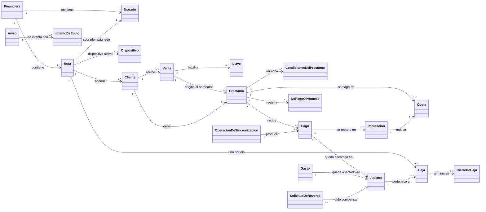

# Entrega 2 — Arquitectura candidata

## 0. Identificación

- **Proyecto:** ROYEXA
- **Integrantes:**
  - Julian Andres Restrepo
- **Grupo:** 10
- **Fecha:** 2026-09-20
- **Commit o etiqueta de entrega:** entrega-2-arquitectura
- **Entrega 1 utilizada como línea base:** [`../01-requisitos/requisitos.md`](../01-requisitos/requisitos.md)

> **Fuente del estado del producto.** El contenido de esta entrega se sincronizó con el repositorio TRACKEA (Discovery, Inception y el Bolt de construcción B1, con estado a 2026-09-20). Donde TRACKEA y la Entrega 1 no coinciden, la arquitectura sigue a TRACKEA y la diferencia queda registrada en la sección [7.1](#71-divergencias-entre-la-entrega-1-y-trackea) con el identificador `DIV-XX`, sin modificar el significado de ningún `RF`, `RN`, `EC`, `ASR` ni `RES` de la Entrega 1.

---

## 1. Modelo conceptual del dominio

### 1.1 Propósito y alcance del modelo

El modelo representa el dominio de la cobranza diaria en calle y de su control antifraude: quién presta, quién cobra, qué se debe, qué dinero se movió, en qué caja quedó y con qué autorización. Deja fuera las tablas, los servicios y el framework.

Permite responder cuatro preguntas que sostienen el propósito del producto:

1. ¿Qué movimientos de dinero existen, quién los ejecutó y cuándo, y puede alguien alterarlos después? (`RF-04`, `RN-04`)
2. ¿Cuánto debe un cliente y cuántas cuotas le quedan, sin errores de redondeo? (`RF-01`, `RN-01`)
3. ¿Cuánto efectivo debe entregar el cobrador al cierre y cuál es el descuadre? (`RF-02`, `RF-07`, `RN-02`)
4. ¿Qué operaciones sensibles necesitan la aprobación de alguien distinto de quien las originó? (`RF-03`, `RN-05`, `RN-06`)

Se relaciona con dos recorridos. El recorrido vertical previsto en la Entrega 1 es el desembolso de un préstamo (`RF-03`, `RF-04`, `RF-06`); en TRACKEA ese desembolso corresponde a la **venta** aprobada en cuatro pasos. El Bolt B1 de construcción ejercita otro recorrido, un cobro registrado sin señal que llega una sola vez al libro de movimientos (`RF-01`, `RF-04`); ambos convergen en el libro de movimientos (ver `DIV-06`).

### 1.2 Representación visual

Fuente editable: [`diagramas/modelo-conceptual.mmd`](diagramas/modelo-conceptual.mmd). Se muestra el mismo diagrama en texto reproducible (Mermaid):

### 1.3 Glosario del dominio

| Término | Definición contextual | Sinónimos o ambigüedades que deben evitarse | Referencias |
|---|---|---|---|
| Financiera | Empresa suscrita que presta y cobra. Es la raíz del aislamiento: los datos de una financiera nunca son visibles para otra. En TRACKEA se llama *tenant*. | No confundir con *cliente*. TRACKEA distingue *customer* (la financiera que paga la suscripción) de *client* (el deudor). | `DIV-03` |
| Cliente | Persona que debe dinero a la financiera y a quien el cobrador visita. Es el deudor. | *Cliente final* (`INT-03`) en la Entrega 1. No es la financiera ni un usuario del sistema. | `INT-03`, `DIV-01` |
| Cobrador | Persona que recorre una ruta, cobra y cierra su caja. En TRACKEA cobrador y gestor son un solo rol. | *Gestor*, *agente de cobro*. | `INT-01`, `RF-01`, `RF-02` |
| Administrador | Usuario que aprueba y verifica. Tiene dos plantillas: principal (todo) y secundario (autoriza el valor de la venta y verifica descuadres; no aprueba sus propias llaves). | *Supervisor*. El socio es otro rol y solo lee. | `INT-02`, `DIV-04`, `DIV-07` |
| Ruta | Recorrido de cobranza que une un cobrador, un dispositivo y un conjunto de clientes. Una ruta usa un dispositivo activo a la vez. | *Zona*. | `RF-02` |
| Venta | Acto de otorgar un préstamo nuevo. Pasa por cuatro estados: documentos cargados, valor autorizado, enviada y aprobada. | *Desembolso*, que es la salida de dinero que la venta produce. La Entrega 1 usa «desembolso» para todo el flujo. | `RF-03`, `RN-03`, `RN-05` |
| Llave | Autorización de un solo uso, atada a un cliente y a una operación, que caduca al usarse o al cerrar la caja. | *Código de confirmación* de la Entrega 1: aquel lo presenta el cliente y caduca por tiempo; la llave la aprueba un administrador y caduca por uso o cierre. | `RN-03`, `RN-06`, `DIV-01` |
| Préstamo | Deuda con interés fijo sobre el capital y cuota indivisible; sin cargo por mora ni descuento por pago anticipado. | *Crédito*. | `RF-05`, `RN-01` |
| Cuota | Parte de un préstamo con fecha de vencimiento en día de cobranza (lunes a sábado). No se descompone en interés y capital. | | `RN-01`, `CA-09` |
| Contador fraccionario | Número de cuotas restantes, que avanza de forma fraccionaria con los pagos parciales (25 sobre una cuota de 50 deja 19,5 de 20). | *Saldo en cuotas enteras*. | `RN-01`, `CA-01`, `EC-03` |
| Pago | Dinero recibido de un cliente, en efectivo o PIX, que se reparte entre las cuotas empezando por la más antigua. | *Cobro* es el acto del cobrador; *pago* es el registro. | `RF-01`, `RN-01` |
| No pago | Visita sin cobro, con motivo y, opcionalmente, una promesa de pago. | | `RF-01`, `CA-02` |
| Caja | Registro del efectivo de una ruta en un día. Se abre y se cierra una sola vez y el cierre es irreversible. | *Arqueo*. | `RF-02`, `RN-02` |
| Descuadre | Diferencia con signo entre el efectivo declarado al cierre y el esperado. Cero no cuenta como descuadre. | | `RF-02`, `RF-07`, `CA-03` |
| Asiento | Registro inalterable de un movimiento de dinero, con importe, tipo, autor y dos marcas de tiempo (dispositivo y servidor). | *Movimiento* o *registro* en la Entrega 1; *ledger* y *libro mayor* en TRACKEA. Los tres nombres son el mismo concepto. | `RF-04`, `RN-04`, `CA-07` |
| Contra-asiento | Asiento que compensa a otro sin borrarlo. Es la única forma de corregir. | *Reversión*, *anulación* (sugieren borrado). | `RN-04`, `CA-08` |
| Operación de sincronización | Instrucción registrada en el teléfono, con identificador único, que se envía al servidor cuando vuelve la señal. | | `RF-01` |
| Aviso | Notificación a un administrador o socio por correo, push o Telegram, con un estado consultable de cada intento de envío. | *Comprobante al cliente final* (`RF-06`) es otro concepto y no existe en v1. | `RF-06`, `EC-04`, `DIV-01` |

### 1.4 Conceptos principales

#### Asiento

- **Tipo conceptual:** Entidad.
- **Definición:** Hecho de dinero que quedó registrado: un pago, un desembolso, un gasto, un movimiento de caja o un contra-asiento.
- **Identidad o valor:** Identificador de asiento. Conserva la caja, el tipo, el importe, la hora informada por el dispositivo, la hora de recepción y quién lo ejecutó.
- **Ciclo de vida o estados:** No aplica. Un asiento nace confirmado y no cambia. Los estados de las solicitudes que lo originan viven en sus dueños (venta, gasto, reversa), no en el asiento.
- **Reglas e invariantes:** `RN-04`: solo se inserta; nunca se modifica ni se borra. Solo el módulo del libro mayor lo escribe.
- **Requisitos relacionados:** `RF-04`, `RF-02`.
- **Criterios relevantes:** `CA-07`, `CA-08`.
- **Relaciones principales:** Pertenece a una caja. Lo originan un pago, un gasto o un desembolso. Una solicitud de reversa apunta a él.

#### Pago

- **Tipo conceptual:** Entidad.
- **Definición:** Dinero recibido de un cliente sobre un préstamo, en efectivo o PIX.
- **Identidad o valor:** Identificador de pago y el identificador de operación con el que llegó del teléfono.
- **Ciclo de vida o estados:** Registrado o en revisión. Un pago sobre un préstamo que al sincronizar ya está pagado, renovado o castigado queda en revisión y no suma a ninguna caja.
- **Reglas e invariantes:** `RN-01`: se imputa a las cuotas más antiguas primero y nunca excede el saldo. El dinero se representa en enteros de centavos, sin redondeo.
- **Requisitos relacionados:** `RF-01`.
- **Criterios relevantes:** `CA-01`, `CA-11`.
- **Relaciones principales:** Pertenece a un préstamo; se reparte en imputaciones sobre cuotas; genera un asiento.

#### Préstamo y cuota

- **Tipo conceptual:** Entidad con objetos de valor (condiciones versionadas).
- **Definición:** Deuda de un cliente, con su calendario de cuotas y las condiciones (tasa y valor de cuota) con las que se otorgó.
- **Identidad o valor:** Identificador de préstamo. Las condiciones son un valor versionado: la tasa y el número de cuotas no cambian tras la venta.
- **Ciclo de vida o estados:** Activo, moroso, pagado y castigado (ver 1.7). La mora es un estado, no un valor que crece.
- **Reglas e invariantes:** `RN-01`: sin interés ni cargo de mora. `RN-05`: renovar exige el préstamo anterior pagado al 100 %.
- **Requisitos relacionados:** `RF-05`.
- **Criterios relevantes:** `CA-09`, `CA-10`.
- **Relaciones principales:** Pertenece a un cliente; nace de una venta; tiene cuotas, pagos y no pagos.

#### Caja

- **Tipo conceptual:** Entidad.
- **Definición:** Efectivo de una ruta en un día, con tres paneles (clientes pendientes, que pagaron y que no pagaron) y distinción entre efectivo y PIX.
- **Identidad o valor:** Una por ruta y día.
- **Ciclo de vida o estados:** Abierta o cerrada (ver 1.7).
- **Reglas e invariantes:** `RN-02`: solo se cierra sin clientes pendientes y el cierre es irreversible; un error posterior se corrige con un contra-asiento en la caja del día siguiente. El efectivo esperado es cobros en efectivo menos préstamos con recaudo, gastos aprobados y remesas informativas; el PIX no entra.
- **Requisitos relacionados:** `RF-02`, `RF-07`.
- **Criterios relevantes:** `CA-03`, `CA-04`, `CA-13`.
- **Relaciones principales:** Pertenece a una ruta; agrupa asientos; termina en un cierre con su descuadre.

#### Venta y llave

- **Tipo conceptual:** Entidad con ciclo de vida (venta) y objeto de valor de un solo uso (llave).
- **Definición:** La venta es la solicitud de un préstamo nuevo que debe autorizarse antes de que salga el dinero. La llave habilita una operación sensible una sola vez.
- **Identidad o valor:** Identificador de venta; la llave queda atada a un cliente y una operación.
- **Ciclo de vida o estados:** Ver 1.7. La llave tiene un máximo de 3 intentos por cliente y día.
- **Reglas e invariantes:** `RN-05`: renovación solo con préstamo liquidado. `RN-06` (con la salvedad de `DIV-07`): un cobrador no autoriza ni aprueba; un administrador secundario no aprueba sus propias llaves.
- **Requisitos relacionados:** `RF-03`, `RF-05`.
- **Criterios relevantes:** `CA-05`, `CA-06`, `CA-10`.
- **Relaciones principales:** Recibida por un cliente; origina un préstamo al aprobarse; puede requerir llaves.

#### Operación de sincronización

- **Tipo conceptual:** Entidad.
- **Definición:** Instrucción del cobrador guardada en el teléfono mientras no había señal (un pago, un no pago, un gasto) y enviada después.
- **Identidad o valor:** Identificador de operación, único. Es la barrera contra duplicados.
- **Ciclo de vida o estados:** Recibida, aplicada, rechazada o en cuarentena (cuando se desvincula el dispositivo). El servidor decide y devuelve el resultado.
- **Reglas e invariantes:** Repetir el mismo identificador devuelve el resultado original y no vuelve a escribir. Cada operación y su efecto se confirman en una sola transacción. Ninguna `RN` de la Entrega 1 la cubre (`DIV-02`).
- **Requisitos relacionados:** `RF-01`, `RF-04`.
- **Criterios relevantes:** `CA-01`, `CA-07`.
- **Relaciones principales:** Produce un pago y su asiento.

#### Aviso

- **Tipo conceptual:** Entidad.
- **Definición:** Notificación a un administrador o socio, con el estado de cada intento de envío.
- **Identidad o valor:** Identificador de aviso, con sus intentos de envío.
- **Ciclo de vida o estados:** Pendiente, enviado o fallido. Tras 5 reintentos se marca fallido y genera alarma.
- **Reglas e invariantes:** Un envío no confirmado nunca aparece como enviado. Un aviso perdido no invalida el dinero (`EC-04`, en su alcance sobre administradores).
- **Requisitos relacionados:** `RF-06` (parcial).
- **Criterios relevantes:** `CA-12`.
- **Relaciones principales:** Se origina en eventos de otros conceptos; tiene intentos de envío.

### 1.5 Relaciones y cardinalidades relevantes

| Origen | Relación | Destino | Cardinalidad | Justificación de dominio |
|---|---|---|---|---|
| Financiera | contiene | Ruta | 1 a 1..* | Toda ruta pertenece a una sola financiera (aislamiento, `DIV-03`). |
| Ruta | tiene asignado | Usuario (cobrador) | 1 a 1 | Una ruta tiene un cobrador (`RF-02`). |
| Ruta | usa | Dispositivo | 1 a 0..1 | Un solo dispositivo activo por ruta. |
| Ruta | abre | Caja | 1 a 0..* | Una caja por ruta y día (`RN-02`). |
| Cliente | recibe | Venta | 1 a 0..* | Un cliente puede tener varias ventas a lo largo del tiempo, una por préstamo. |
| Venta | origina | Préstamo | 1 a 0..1 | Solo una venta aprobada crea un préstamo (`RN-05`). |
| Préstamo | se paga en | Cuota | 1 a 1..* | El calendario se deriva del monto, el plazo y el interés (`CA-09`). |
| Préstamo | recibe | Pago | 1 a 0..* | Un préstamo admite varios pagos parciales (`RN-01`). |
| Pago | se reparte en | Imputación | 1 a 1..* | Un pago mayor que la cuota avanza a las siguientes (`RN-01`). |
| Pago | queda asentado en | Asiento | 1 a 1 | Todo pago deja su asiento (`RN-04`, `CA-07`). |
| Asiento | pertenece a | Caja | * a 1 | Cada asiento se asigna a la caja de la ruta y el día (`RN-02`). |
| Solicitud de reversa | pide compensar | Asiento | 0..* a 1 | Corregir es agregar un contra-asiento (`RN-04`, `CA-08`). |
| Caja | termina en | Cierre | 1 a 0..1 | El cierre calcula el descuadre (`CA-03`). |
| Operación de sincronización | produce | Pago | 1 a 0..1 | Una operación aplicada crea un solo pago. |

### 1.6 Reglas e invariantes representadas

| Regla o invariante | Conceptos involucrados | Límite de consistencia | Efecto sobre el modelo |
|---|---|---|---|
| `RN-01` Contador fraccionario | Pago, Imputación, Cuota, Préstamo | Un pago, sus imputaciones, su asiento y el contador se confirman juntos | El pago se reparte de la cuota más antigua a la más reciente; el contador avanza de forma fraccionaria; el dinero nunca es un decimal binario. |
| `RN-02` Cierre de caja | Caja, Cierre, Cliente | Una caja | Sin pendientes para cerrar; tras el cierre no se reabre ni se edita. |
| `RN-03` Liberación del dinero | Venta, Llave, Asiento | Una venta | El dinero solo sale con la venta aprobada y la llave (de TRACKEA) o el código (de la Entrega 1, `DIV-01`). |
| `RN-04` Solo inserción | Asiento, Solicitud de reversa | El libro de movimientos | Ningún asiento se modifica ni se borra; la corrección es un contra-asiento visible. |
| `RN-05` Renovación | Venta, Préstamo | Un cliente | Una venta nueva exige el préstamo anterior liquidado, salvo excepción explícita. |
| `RN-06` Quien origina no aprueba | Venta, Llave, Usuario | Una solicitud | Un rol no aprueba lo que originó; excepción en `DIV-07`. |
| `INV-01` El saldo lo calcula el servidor | Préstamo, Pago, Asiento | El servidor | El teléfono no fija saldos; los recibe. Derivada de `RN-01` y `RN-04`. |
| `INV-02` Identificador de operación único | Operación de sincronización, Pago | Una operación | Un reintento no duplica. Derivada de `RN-04` (nada se escribe dos veces). |
| `INV-03` Aislamiento | Todas las entidades de negocio | La financiera | Toda entidad lleva su financiera y ninguna consulta cruza financieras (`DIV-03`). |

### 1.7 Estados y transiciones relevantes

| Concepto | Estado inicial | Evento o acción | Estado resultante | Precondición o regla |
|---|---|---|---|---|
| Venta | Documentos cargados | El administrador secundario autoriza el valor | Valor autorizado | Solo administradores; un cobrador recibe 403. |
| Venta | Valor autorizado | La venta se envía a aprobación | Enviada | Sigue el orden de los cuatro pasos. |
| Venta | Enviada | Un administrador la aprueba | Aprobada | Tasa y número de cuotas quedan inmutables (`RN-05`). |
| Caja | Abierta | El cobrador cierra sin clientes pendientes | Cerrada | `RN-02`, `CA-03`. Con pendientes se rechaza (`CA-04`). |
| Caja | Cerrada | Cualquier intento de reabrirla o registrar un pago con su fecha | Cerrada | `RN-02`. La corrección va como contra-asiento en la caja siguiente. |
| Llave | Pedida | El administrador principal la aprueba | Aprobada | Los secundarios no aprueban sus propias llaves (`RN-06`, `DIV-07`). |
| Llave | Aprobada | Se usa, o se cierra la caja | Usada o caducada | Un solo uso; con 3 intentos fallidos por cliente y día se bloquea. |
| Préstamo | Activo | La cuota impaga más antigua vence hace 3 días | Moroso | Sin cargo. Al pagar las cuotas vencidas deja de ser moroso. El umbral de 3 días está pendiente de confirmar por el cliente. |
| Préstamo | Moroso | Un administrador principal lo marca con motivo | Castigado | No existe paso automático. |

### 1.8 Contextos delimitados preliminares

Los contextos son un vocabulario y una responsabilidad de negocio, no contenedores. Todos se ejecutan dentro del mismo servicio (ver `AD-02`); las catorce piezas internas que TRACKEA llama módulos se agrupan aquí por afinidad de negocio.

| Contexto preliminar | Responsabilidad de negocio | Conceptos principales | Relaciones con otros contextos |
|---|---|---|---|
| Identidad y acceso | Quién es cada usuario, qué puede hacer, con qué dispositivo y qué términos aceptó. | Financiera, Ruta, Usuario, Dispositivo | Todos los demás lo consultan para saber quién actúa. |
| Crédito | Quién debe qué y bajo qué condiciones; autorización de nuevos préstamos. | Cliente, Venta, Llave, Préstamo, Cuota | Consume identidad; alimenta cobranza. |
| Cobranza y dinero | Registrar el dinero, repartirlo y controlar la caja. | Pago, Imputación, Caja, Cierre, Asiento, Gasto, Solicitud de reversa | Consume crédito; es la fuente de eventos para avisos y reportes. |
| Sincronización | Recibir las operaciones sin señal una sola vez y despacharlas al contexto que corresponde. | Operación de sincronización | Despacha hacia crédito, cobranza e identidad. |
| Avisos y reportes | Informar a administradores y socios y medir los descuadres. | Aviso, Intento de envío, tablero | Solo lee eventos; ningún otro contexto lo llama. |

### 1.9 Comprobación del modelo

#### Escenario principal

Se usa el flujo de la Entrega 1 (desembolso de un préstamo), adaptado a las decisiones de TRACKEA (`DIV-01`).

- **Entrada:** el cobrador, con señal, crea la venta de un cliente de su ruta con sus documentos.
- **Conceptos participantes:** Cobrador, Cliente, Venta, Llave, Préstamo, Cuota, Asiento, Caja.
- **Reglas activadas:** `RN-05` (el cliente no puede tener un préstamo anterior sin liquidar), `RN-06` (el cobrador no autoriza ni aprueba), `RN-03` (el dinero sale con la aprobación y la llave), `RN-04`.
- **Estados modificados:** Venta: documentos cargados, valor autorizado, enviada y aprobada. Llave: pedida, aprobada y usada.
- **Resultado:** el préstamo queda activo con su calendario de cuotas inmutable, el desembolso queda asentado en el libro de movimientos con quién lo solicitó y quién lo aprobó, y el importe se descuenta del efectivo esperado de la caja.

#### Caso límite 1: reintento del mismo cobro sin señal

- **Condición:** el teléfono envía un lote, se corta la conexión antes de recibir la respuesta y vuelve a enviar el mismo lote.
- **Conceptos participantes:** Operación de sincronización, Pago, Asiento.
- **Reglas o invariantes:** `RN-04`, `INV-02`.
- **Respuesta esperada:** el segundo envío devuelve el resultado original, marcado como duplicado. Existe un solo pago y un solo asiento.

#### Caso límite 2: un administrador secundario intenta aprobar su propia llave

- **Condición:** un administrador secundario pide una llave y luego intenta aprobarla.
- **Conceptos participantes:** Llave, Usuario.
- **Reglas o invariantes:** `RN-06`, `EC-02`.
- **Respuesta esperada:** el sistema lo rechaza y la llave sigue sin emitirse. Solo el administrador principal puede aprobar la suya y queda registrado quién, con qué rol y cuándo (`DIV-07`).

#### Caso límite 3: pago sin señal sobre un préstamo que ya se pagó

- **Condición:** el cobrador registra un pago sin señal; antes de sincronizar, el préstamo se pagó, se renovó o se castigó.
- **Conceptos participantes:** Pago, Préstamo, Caja.
- **Reglas o invariantes:** `RN-01` (nunca se imputa más que el saldo), `RN-02`.
- **Respuesta esperada:** el pago queda en revisión, no suma a ningún panel de caja y el administrador recibe una alerta.

### 1.10 Preguntas abiertas del modelo

- ¿La Entrega 1 debe reformularse para incluir la operación sin conexión y el aislamiento entre financieras, o la arquitectura debe volver al alcance original? (`DIV-02`, `DIV-03`)
- ¿Se mantiene el cliente final (`INT-03`) como destinatario de comprobantes, o pasa a ser un actor de una versión posterior? (`DIV-01`)
- ¿`RN-06` admite la excepción de que el administrador principal apruebe sus propias llaves? (`DIV-07`)
- ¿Son definitivos el umbral de mora de 3 días y el umbral de divergencia de reloj de 24 horas? Están pendientes de confirmar por el cliente.

---

## 2. Asuntos de decisión arquitectónica

### 2.1 Inventario inicial

| ID | Asunto formulado como pregunta neutral | Origen | Interesados afectados | Importancia y costo de cambio | Estado |
|---|---|---|---|---|---|
| AD-01 | ¿Cómo garantizar que un movimiento de dinero, una vez confirmado, no pueda alterarse ni borrarse, incluso si el código de la aplicación falla? | `ASR-01`, `EC-01`, `RN-04`, `RF-04` | `INT-01`, `INT-02` | Es la razón de ser del producto. Cambiarlo con datos reales obliga a migrar el historial del libro. | Analizado (`ADR-001`) |
| AD-02 | ¿Cómo organizar y comunicar las partes del sistema para que el dinero se confirme de forma atómica y un fallo en los avisos no lo invalide ni pase inadvertido? | `ASR-01`, `ASR-02`, `ASR-05`, `EC-04`, `RES-02`, `RES-03` | `INT-01`, `INT-02` | Fija la unidad de despliegue y las fronteras internas; es muy costoso de deshacer una vez que hay código. | Analizado (`ADR-002`) |
| AD-03 | ¿Cómo asegurar que un cobro registrado sin señal llegue una sola vez, sin duplicarse ni perderse? | `ASR-01`, `RF-01`, `RN-04`, `EC-01`; `DIV-02` | `INT-01`, `INT-02` | Condiciona el diseño del teléfono y del servidor y es el mayor riesgo técnico declarado en TRACKEA. | Analizado (`ADR-003`) |
| AD-04 | ¿Cómo evitar que los datos de una financiera sean visibles para otra sobre una misma instalación? | `DIV-03`; `RES-04` | `INT-02` | Un fallo expone datos personales y financieros de terceros. Cambiarlo después obliga a rehacer el esquema. | Pendiente de análisis comparativo. TRACKEA ya fijó la seguridad por fila con el contexto de la financiera por transacción. |
| AD-05 | ¿Cómo representar y calcular importes y cuotas sin error de redondeo acumulado? | `ASR-04`, `EC-03`, `RN-01` | `INT-01`, `INT-02` | El error se acumula cuota a cuota y la caja deja de cuadrar. | Pendiente de análisis comparativo. TRACKEA ya fijó enteros de centavos y funciones puras. |
| AD-06 | ¿Cómo hacer cumplir en el servidor, y no solo en la interfaz, que quien origina una operación no la aprueba? | `ASR-03`, `EC-02`, `RN-06` | `INT-02` | Un hueco aquí habilita el fraude que el producto combate. | Pendiente. TRACKEA evalúa permisos y no roles fijos; se construye en los Bolts B3 y B6. |
| AD-07 | ¿Cómo hacer que el resultado de cada envío de aviso quede registrado y consultable? | `ASR-05`, `EC-04`, `RF-06` | `INT-02` | Un aviso perdido sin estado rompe el control en silencio. | Cubierto dentro de `AD-02`. |

### 2.2 Priorización

Se analizan en profundidad `AD-01`, `AD-02` y `AD-03` por tres razones. Primero, cada uno nace de un `ASR` de la Entrega 1 o del riesgo técnico más alto de TRACKEA. Segundo, son las decisiones más caras de cambiar una vez que hay datos y código. Tercero, los tres se ejercitan en el primer recorrido vertical: `AD-01` con el libro de movimientos, `AD-02` con la confirmación atómica y los avisos, `AD-03` con el cobro sin señal del Bolt B1.

`AD-04`, `AD-05` y `AD-06` no se desarrollan porque TRACKEA ya tiene una decisión tomada para cada uno y el enunciado pide profundizar solo en dos o tres asuntos. Se dejan en el inventario y en la trazabilidad como decisiones heredadas que necesitan evidencia (`EV-07`, `EV-10`, `EV-11`). `AD-07` se resuelve como consecuencia de `AD-02`.

---

## 3. Evaluación de alternativas arquitectónicas

### 3.1 AD-01 — Inalterabilidad del libro de movimientos

#### Asunto de decisión

> ¿Cómo garantizar que un movimiento de dinero, una vez confirmado, no pueda alterarse ni borrarse, incluso si el código de la aplicación falla?

#### Contexto y trazabilidad

- **ASR relacionados:** `ASR-01`
- **Requisitos funcionales:** `RF-04`, `RF-02`, `RF-03`
- **Reglas o invariantes:** `RN-04`, `INV-02`
- **Escenarios de calidad:** `EC-01`
- **Restricciones:** `RES-04`, `RES-02`
- **Interesados afectados:** `INT-01`, `INT-02`
- **Riesgos iniciales:** `RA-01`, `RA-02`

#### Criterios de evaluación

##### Obligatorios

- **O1.** El rechazo de una modificación o un borrado debe ocurrir aunque el código de la aplicación tenga un defecto o reciba una consulta manipulada (`EC-01`: el 100 % de los intentos se rechaza).
- **O2.** La corrección de un error debe dejar visibles el asiento original y el compensatorio (`RN-04`).
- **O3.** El asiento y su efecto sobre el pago, el saldo y la caja deben confirmarse juntos o no confirmarse.

##### Prioritarios

- **P1.** Verificable con una prueba automatizada repetible (forma de verificación de `EC-01`).
- **P2.** Operable por un equipo mínimo (`RES-02`; en TRACKEA, un solo desarrollador).
- **P3.** Sin servicios de pago adicionales al presupuesto de infraestructura de TRACKEA (unos 185 a 195 USD al mes).

##### Deseables

- **D1.** Que la manipulación por parte de quien tenga acceso privilegiado a la base de datos deje evidencia.

#### ALT-01A — Inalterabilidad por convención en la aplicación

- **Descripción:** El código no ofrece operaciones de actualizar ni borrar sobre el libro. La tabla admite `UPDATE` y `DELETE` al rol que usa la aplicación.
- **Supuestos:** Todo acceso a la tabla pasa por el código de la aplicación y este no tiene defectos.
- **Beneficios:** Sin configuración adicional de la base de datos. La más simple de construir.
- **Costos o sacrificios:** La garantía vive solo en el código y no puede demostrarse a alguien que desconfíe de él.
- **Riesgos:** Un defecto, una consulta cruda o una inyección de SQL alteran el pasado sin que nada lo impida (`RA-01`).
- **Puntos sensibles:** Los privilegios efectivos del rol de la aplicación.
- **Elementos arquitectónicos afectados:** `CON-03`, `CON-04`.
- **Evidencia disponible:** Ninguna.
- **Evidencia necesaria:** `EV-01`.

#### ALT-01B — Solo inserción garantizada por privilegios de la base de datos y un único módulo escritor

- **Descripción:** El rol de la aplicación solo tiene `INSERT` y `SELECT` sobre el libro; se le retiran explícitamente `UPDATE`, `DELETE` y `TRUNCATE`. Un rol distinto ejecuta las migraciones. Un solo módulo (el libro mayor) escribe la tabla y los demás le piden los asientos. Las correcciones son contra-asientos y el saldo es la suma de los asientos. Los estados de las solicitudes (venta, gasto, reversa) viven en sus módulos dueños, no en el libro.
- **Supuestos:** `SUP-01`.
- **Beneficios:** El rechazo lo hace la base de datos, aunque el código falle. La garantía se demuestra con una prueba automatizada que intenta alterar el libro con el rol de la aplicación.
- **Costos o sacrificios:** Los privilegios deben mantenerse correctos en cada migración. Cada operación de dinero pasa por una llamada más. Un dato derivado mutable (el efectivo esperado de la caja) debe actualizarse en la misma transacción.
- **Riesgos:** Una migración con una concesión demasiado amplia anula la garantía (`RA-01`). Quien tenga el rol propietario puede alterar el libro (`RA-02`).
- **Puntos sensibles:** El conjunto de privilegios sobre el libro y sobre el registro de cambios.
- **Elementos arquitectónicos afectados:** `CON-03`, `CON-04`.
- **Evidencia disponible:** Existe la migración con el libro y una prueba de aceptación que intenta alterar una fila con el rol de la aplicación. No hay resultado de su ejecución registrado en TRACKEA.
- **Evidencia necesaria:** `EV-01`, `EV-02`.

#### ALT-01C — Cadena de hashes sobre los asientos

- **Descripción:** Cada asiento guarda un valor calculado a partir del anterior y un proceso periódico verifica la cadena. La tabla admite modificaciones pero cualquier cambio rompe la cadena.
- **Supuestos:** Es posible serializar el cálculo de la cadena por caja sin degradar el registro de cobros concurrentes.
- **Beneficios:** Detecta la manipulación incluso de quien tenga acceso privilegiado.
- **Costos o sacrificios:** Detecta, no impide. Añade un cálculo serializado a cada inserción y un proceso de verificación que operar.
- **Riesgos:** La alteración puede tardar en detectarse hasta la siguiente verificación. Puede degradar el rendimiento del cobro.
- **Puntos sensibles:** La concurrencia de escrituras sobre una misma caja.
- **Elementos arquitectónicos afectados:** `CON-03`, `CON-04`.
- **Evidencia disponible:** Ninguna.
- **Evidencia necesaria:** Medir el costo de la cadena bajo cobros concurrentes (no planificada).

#### Comparación

| Criterio | Tipo | ALT-01A | ALT-01B | ALT-01C | Observaciones y evidencia faltante |
|---|---|---|---|---|---|
| O1 Rechazo aunque falle el código | Obligatorio | No cumple | Cumple bajo una condición | No cumple | En 01B, si los privilegios se mantienen en cada migración (`EV-02`). 01C no impide el cambio, lo detecta. |
| O2 Corrección visible | Obligatorio | Cumple | Cumple | Cumple | Las tres usan contra-asientos. |
| O3 Confirmación conjunta | Obligatorio | Cumple | Cumple | Requiere evidencia | En 01C la cadena añade un paso serializado a la misma transacción. |
| P1 Prueba automatizada | Prioritario | Introduce un riesgo | Cumple | Requiere evidencia | En 01A la prueba solo demostraría que el código no ofrece la operación. |
| P2 Operable por un equipo mínimo | Prioritario | Cumple | Cumple bajo una condición | Introduce un riesgo | 01B exige disciplina en las migraciones; 01C añade un proceso periódico. |
| P3 Sin costo adicional | Prioritario | Cumple | Cumple | Cumple | Ninguna añade servicios de pago. |
| D1 Evidencia frente a privilegiados | Deseable | No cumple | No cumple | Cumple | Solo 01C. Puede añadirse después sobre 01B. |

#### Decisión provisional

- **Alternativa seleccionada:** ALT-01B.
- **Justificación:** Es la única que cumple el criterio obligatorio de rechazo aunque falle el código y que permite demostrarlo con una prueba automatizada, que es la forma de verificación de `EC-01`. Se apoya en la decisión ya tomada en TRACKEA (rol de la aplicación sin actualización ni borrado, roles separados y libro con un solo escritor).
- **Alternativas descartadas:** ALT-01A por incumplir el criterio obligatorio. ALT-01C como decisión principal porque detecta pero no impide y añade costo de concurrencia; se conserva como refuerzo posible (ver condiciones de revisión).
- **Consecuencias positivas:** La garantía antifraude tiene un solo lugar donde probarse. Un defecto de código no puede alterar el pasado.
- **Consecuencias negativas aceptadas:** Cada operación de dinero pasa por una llamada más. Los privilegios exigen una prueba de ausencia en cada migración. El propietario de la base sigue pudiendo alterar el libro.
- **Riesgos pendientes:** `RA-01`, `RA-02`.
- **Supuestos pendientes:** `SUP-01`.
- **Evidencia por obtener:** `EV-01`, `EV-02`.
- **Condiciones de revisión:** Si `EV-02` encuentra privilegios de más que no pueden mantenerse de forma estable, o si un requisito exige detectar la manipulación por privilegiados, se añade ALT-01C.
- **ADR correspondiente:** [`ADR-001`](adr/ADR-001-libro-de-movimientos-de-solo-insercion.md)

---

### 3.2 AD-02 — Organización y comunicación de las partes del sistema

#### Asunto de decisión

> ¿Cómo organizar y comunicar las partes del sistema para que el dinero se confirme de forma atómica y un fallo en los avisos no lo invalide ni pase inadvertido?

#### Contexto y trazabilidad

- **ASR relacionados:** `ASR-01`, `ASR-02`, `ASR-05`
- **Requisitos funcionales:** `RF-01`, `RF-03`, `RF-04`, `RF-06`
- **Reglas o invariantes:** `RN-04`, `RN-06`
- **Escenarios de calidad:** `EC-01`, `EC-04`
- **Restricciones:** `RES-02`, `RES-03`
- **Interesados afectados:** `INT-01`, `INT-02`
- **Riesgos iniciales:** `RA-03`, `RA-04`

#### Criterios de evaluación

##### Obligatorios

- **O1.** Un pago, su asiento, su imputación y el efecto sobre la caja se confirman en una sola transacción (`RN-04`, `ASR-01`).
- **O2.** El fallo de un canal de aviso no revierte ni bloquea la operación de dinero, y el envío no confirmado queda visible como fallido o pendiente (`EC-04`, `ASR-05`).
- **O3.** Debe poder ejecutarse en un entorno local para las pruebas (`RES-02`).

##### Prioritarios

- **P1.** Fronteras claras con un dueño único por cada regla de negocio.
- **P2.** Operable y mantenible por un equipo mínimo (`RES-02`; en TRACKEA, un solo desarrollador).
- **P3.** Costo de infraestructura contenido (unos 185 a 195 USD al mes en TRACKEA).
- **P4.** Los canales de aviso son reemplazables sin tocar la lógica de negocio (`RES-03`).

##### Deseables

- **D1.** Que una parte pueda separarse después sin reescribir las demás.

#### ALT-02A — Monolito modular con llamadas directas para lo atómico y eventos por una cola en la base de datos solo hacia avisos y reportes

- **Descripción:** Un solo servicio desplegable dividido en módulos por regla de negocio. Los módulos se llaman dentro del mismo proceso cuando la operación debe ser atómica. Los eventos viajan por una cola que vive en PostgreSQL, se encolan en la misma transacción y solo los leen los módulos de avisos y reportes. Ningún módulo de negocio llama al de avisos.
- **Supuestos:** `SUP-03`.
- **Beneficios:** Conserva la atomicidad del dinero. Los productores no conocen a los consumidores. Un solo despliegue y una sola base de datos que operar.
- **Costos o sacrificios:** Más carpetas y fronteras que mantener con un solo desarrollador. Un evento perdido deja sin alerta a un administrador, aunque no afecta al dinero.
- **Riesgos:** `RA-03`, `RA-04`.
- **Puntos sensibles:** El grafo de dependencias entre módulos y el tamaño de la transacción.
- **Elementos arquitectónicos afectados:** `CON-03`, `CON-04`, `EXT-01`, `EXT-02`, `EXT-03`.
- **Evidencia disponible:** Existen los módulos de dinero, sincronización y libro en el código de B1; la cola de trabajos no tiene trabajos reales hasta el Bolt B3.
- **Evidencia necesaria:** `EV-03`, `EV-04`, `EV-08`.

#### ALT-02B — Servicios independientes por dominio con mensajería asíncrona

- **Descripción:** El dinero, la sincronización y los avisos son servicios separados que se comunican por un intermediario de mensajes. Cada uno tiene su almacenamiento.
- **Supuestos:** Existe capacidad para operar varios servicios, un intermediario de mensajes y trazado distribuido.
- **Beneficios:** Escalado y despliegue independientes. Aislamiento de fallos por servicio.
- **Costos o sacrificios:** El pago y su asiento cruzarían servicios, así que la atomicidad exigiría coordinación distribuida. Más piezas que operar y más costo de infraestructura.
- **Riesgos:** Un asiento confirmado sin el efecto correspondiente si la coordinación falla (rompe `RN-04`).
- **Puntos sensibles:** La consistencia entre el pago y el asiento.
- **Elementos arquitectónicos afectados:** Todos los contenedores; introduce un intermediario de mensajes.
- **Evidencia disponible:** Ninguna.
- **Evidencia necesaria:** Prototipo de la coordinación (no planificado).

#### ALT-02C — Monolito con llamadas directas para todo, incluidos los avisos, dentro de la misma transacción

- **Descripción:** Un solo servicio. Confirmar un pago envía el aviso en el mismo flujo, sin cola de eventos.
- **Supuestos:** Los canales de aviso responden siempre y rápido.
- **Beneficios:** La más simple. El estado del aviso se conoce al instante.
- **Costos o sacrificios:** Cada módulo de negocio conoce a los canales. El tablero se recalcularía por cada operación.
- **Riesgos:** Un canal caído bloquea o revierte el cobro; o, si se ignora el error, el envío falla en silencio (rompe `EC-04`).
- **Puntos sensibles:** El tiempo de respuesta de los canales externos.
- **Elementos arquitectónicos afectados:** `CON-03`, `EXT-01`, `EXT-02`, `EXT-03`.
- **Evidencia disponible:** Ninguna.
- **Evidencia necesaria:** `EV-03`.

#### Comparación

| Criterio | Tipo | ALT-02A | ALT-02B | ALT-02C | Observaciones y evidencia faltante |
|---|---|---|---|---|---|
| O1 Confirmación atómica del dinero | Obligatorio | Cumple | Introduce un riesgo | Cumple | 02B requiere coordinación distribuida. |
| O2 Fallo de aviso sin invalidar el dinero y visible | Obligatorio | Cumple bajo una condición | Cumple bajo una condición | No cumple | 02A: si los reintentos y el estado fallido funcionan (`EV-03`). |
| O3 Ejecutable en local | Obligatorio | Cumple | Requiere evidencia | Cumple | 02B exige levantar varios servicios y un intermediario. |
| P1 Dueño único por regla | Prioritario | Cumple | Cumple | Introduce un riesgo | En 02C todos los módulos conocen los canales. |
| P2 Operable por un equipo mínimo | Prioritario | Cumple bajo una condición | No cumple | Cumple | 02A exige cuidar las fronteras (`RA-04`). |
| P3 Costo contenido | Prioritario | Cumple | No cumple | Cumple | 02B añade servicios y un intermediario. |
| P4 Canales reemplazables | Prioritario | Cumple | Cumple | Introduce un riesgo | En 02A y 02B el canal es un adaptador; ver `EV-08`. |
| D1 Separación posterior | Deseable | Cumple | Cumple | No cumple | 02A conserva fronteras que permiten separar después. |

#### Decisión provisional

- **Alternativa seleccionada:** ALT-02A.
- **Justificación:** Es la única que cumple a la vez la atomicidad del dinero (O1) y la independencia del aviso respecto del dinero (O2) con la capacidad de un equipo mínimo y el costo previsto. Coincide con la decisión ya tomada en TRACKEA.
- **Alternativas descartadas:** ALT-02B por incumplir P2 y P3 y por poner en riesgo O1. ALT-02C por incumplir O2.
- **Consecuencias positivas:** El dinero se confirma de forma atómica. Los productores no conocen a los consumidores. El grafo de módulos es acíclico.
- **Consecuencias negativas aceptadas:** Más fronteras internas que mantener. La cola de eventos comparte la base de datos con el dominio.
- **Riesgos pendientes:** `RA-03`, `RA-04`.
- **Supuestos pendientes:** `SUP-03`.
- **Evidencia por obtener:** `EV-03`, `EV-04`, `EV-08`.
- **Condiciones de revisión:** Si `EV-04` no cumple los tiempos con dos tareas, o si el volumen supera el previsto de unos 6.000 clientes, se reconsidera la separación de módulos.
- **ADR correspondiente:** [`ADR-002`](adr/ADR-002-monolito-modular-con-eventos-para-avisos.md)

---

### 3.3 AD-03 — Cobros sin señal que llegan una sola vez

#### Asunto de decisión

> ¿Cómo asegurar que un cobro registrado sin señal llegue una sola vez, sin duplicarse ni perderse?

#### Contexto y trazabilidad

- **ASR relacionados:** `ASR-01`
- **Requisitos funcionales:** `RF-01`, `RF-04`
- **Reglas o invariantes:** `RN-04`, `RN-01`, `INV-02`
- **Escenarios de calidad:** `EC-01`, `EC-03`
- **Restricciones:** `RES-04`; y `DIV-02` respecto del alcance de la Entrega 1
- **Interesados afectados:** `INT-01`, `INT-02`
- **Riesgos iniciales:** `RA-05`, `RA-06`, `RA-07`

#### Criterios de evaluación

##### Obligatorios

- **O1.** Un cobro registrado no puede duplicarse ni perderse (integridad de `ASR-01`; requisito de integridad de TRACKEA).
- **O2.** El cobrador debe poder registrar un cobro cuando no hay señal, y ese registro debe quedar firme (interesado 1 de la propuesta).
- **O3.** Los datos guardados en el teléfono deben estar cifrados (`RES-04`).

##### Prioritarios

- **P1.** Los reintentos ante cortes son seguros.
- **P2.** El servidor decide el resultado y lo explica al cobrador (por ejemplo, un pago sobre un préstamo ya pagado).
- **P3.** Complejidad asumible por un desarrollador sin experiencia móvil previa.

##### Deseables

- **D1.** Bajo consumo de datos: la jornada de un cobrador cabe en menos de 1 minuto de conexión 4G.

#### ALT-03A — Aplicación solo en línea

- **Descripción:** El cobro se registra directamente en el servidor. Sin señal, el cobrador anota en papel y registra después.
- **Supuestos:** La ruta tiene señal suficiente durante la jornada.
- **Beneficios:** Sin cola local, sin sincronización y sin duplicados posibles. Es el alcance de la Entrega 1 (interfaz web).
- **Costos o sacrificios:** El registro depende de la señal. El papel reintroduce el hueco de «cobrar y no registrar».
- **Riesgos:** El cobrador no puede demostrar de inmediato lo cobrado, que es la preocupación de `INT-01`.
- **Puntos sensibles:** El porcentaje de la jornada sin señal.
- **Elementos arquitectónicos afectados:** `CON-02` como única interfaz de registro; sin `CON-01`.
- **Evidencia disponible:** Ninguna.
- **Evidencia necesaria:** Medir la proporción de visitas sin señal en la ruta piloto (no planificada).

#### ALT-03B — Cola local cifrada, lotes con identificador único de operación y descarga incremental por cursor

- **Descripción:** El teléfono guarda cada operación en una base local cifrada con un identificador único. Al volver la señal envía lotes de hasta 100 operaciones. El servidor usa el identificador como barrera de idempotencia: repetir el identificador devuelve el resultado original. Ordena las operaciones por préstamo, guarda el resultado y publica los cambios que el teléfono descarga por cursor.
- **Supuestos:** `SUP-04`, `SUP-05`.
- **Beneficios:** El cobro queda firme en el teléfono aunque no haya señal. Los reintentos son seguros. El servidor conserva la decisión.
- **Costos o sacrificios:** El teléfono concentra el riesgo técnico: base cifrada, cola, reintentos y pantallas. Hay que definir qué acciones no se permiten sin señal (una venta nueva, pedir una llave o cerrar la caja).
- **Riesgos:** `RA-05`, `RA-06`, `RA-07`.
- **Puntos sensibles:** El tamaño del lote, el número de sentencias por operación y el nivel de seguridad del almacén de claves del teléfono.
- **Elementos arquitectónicos afectados:** `CON-01`, `CON-03`, `CON-04`.
- **Evidencia disponible:** Existen pruebas de integración del servidor sobre el reintento del mismo identificador, el lote de 101, la atomicidad y la descarga por cursor. La aplicación móvil aún no existe (`mobile/` está vacía).
- **Evidencia necesaria:** `EV-05`, `EV-06`.

#### ALT-03C — Réplica local con sincronización bidireccional y fusión automática

- **Descripción:** El teléfono guarda una copia de las entidades y ambas partes reconcilian los cambios con una regla automática (por ejemplo, gana la última escritura).
- **Supuestos:** Los conflictos pueden resolverse sin intervención humana.
- **Beneficios:** El cobrador ve y edita datos con más libertad sin señal.
- **Costos o sacrificios:** Una regla de «gana la última escritura» puede sobrescribir dinero. Contradice el libro de solo inserción (`RN-04`).
- **Riesgos:** Un pago perdido o alterado por la fusión.
- **Puntos sensibles:** La regla de resolución de conflictos.
- **Elementos arquitectónicos afectados:** `CON-01`, `CON-03`, `CON-04`.
- **Evidencia disponible:** Ninguna.
- **Evidencia necesaria:** Ninguna prevista: se descarta por incumplir O1.

#### Comparación

| Criterio | Tipo | ALT-03A | ALT-03B | ALT-03C | Observaciones y evidencia faltante |
|---|---|---|---|---|---|
| O1 Ni duplicado ni perdido | Obligatorio | Cumple bajo una condición | Cumple bajo una condición | No cumple | 03A depende de que el registro en papel se transcriba; 03B, de `EV-05`. |
| O2 Registro firme sin señal | Obligatorio | No cumple | Cumple bajo una condición | Cumple | 03B: si el teléfono cumple `EV-06`. |
| O3 Datos locales cifrados | Obligatorio | Cumple | Requiere evidencia | Requiere evidencia | En 03B depende de la biblioteca de cifrado y del almacén de claves (`RA-06`). |
| P1 Reintentos seguros | Prioritario | Cumple | Cumple | Introduce un riesgo | En 03B por el identificador único. |
| P2 El servidor explica el resultado | Prioritario | Cumple | Cumple | No cumple | En 03C la fusión oculta la decisión. |
| P3 Complejidad asumible | Prioritario | Cumple | Introduce un riesgo | No cumple | 03B concentra el riesgo declarado en TRACKEA (`RA-06`). |
| D1 Bajo consumo de datos | Deseable | Cumple | Cumple | Requiere evidencia | |

#### Decisión provisional

- **Alternativa seleccionada:** ALT-03B.
- **Justificación:** Es la única que cumple el criterio de registro firme sin señal (O2) y mantiene la integridad (O1) con el servidor como autoridad. Coincide con la decisión ya tomada en TRACKEA. **Esta decisión depende de `DIV-02`:** la Entrega 1 excluye la operación sin conexión. Si el docente confirma esa exclusión, la decisión debe revisarse hacia ALT-03A.
- **Alternativas descartadas:** ALT-03A porque deja el registro sujeto a la señal, que es el problema de `INT-01`. ALT-03C porque puede sobrescribir dinero y contradice `RN-04`.
- **Consecuencias positivas:** El cobro queda firme en el teléfono. Los reintentos no duplican. El servidor conserva la decisión y la explica.
- **Consecuencias negativas aceptadas:** Riesgo técnico concentrado en el teléfono. Acciones deshabilitadas sin señal. Un contrato de sincronización que debe versionarse.
- **Riesgos pendientes:** `RA-05`, `RA-06`, `RA-07`.
- **Supuestos pendientes:** `SUP-04`, `SUP-05`.
- **Evidencia por obtener:** `EV-05`, `EV-06`.
- **Condiciones de revisión:** Si `DIV-02` se resuelve excluyendo la operación sin conexión; si el cifrado local no supera la verificación previa en el Android de referencia; si la proporción de visitas sin señal resulta baja.
- **ADR correspondiente:** [`ADR-003`](adr/ADR-003-sincronizacion-idempotente-por-identificador-de-operacion.md)

---

## 4. Consolidación de la arquitectura candidata

### 4.1 Síntesis

Las tres decisiones forman una sola idea: el dinero solo se escribe en un lugar, una vez y sin posibilidad de alteración, y todo lo demás se organiza alrededor de esa garantía.

- `AD-01` fija que el libro de movimientos solo admite inserciones y que lo garantiza la base de datos, no la disciplina del código.
- `AD-03` fija cómo un cobro sin señal llega a ese libro una sola vez: el teléfono guarda cada operación con un identificador único, y el servidor usa ese identificador para no repetir el efecto.
- `AD-02` fija dónde vive la lógica y cómo se comunican las partes: un solo servicio, dividido en módulos con dueños claros, donde el dinero se confirma en una transacción y los avisos salen por eventos, de modo que un fallo de aviso no toca el dinero pero queda registrado.

Las decisiones heredadas `AD-04`, `AD-05` y `AD-06` refuerzan esa idea: la seguridad por fila aísla a cada financiera, los importes son enteros de centavos y los permisos se evalúan en el servidor.

### 4.2 Organización general

- **Sistema objeto de estudio:** ROYEXA, registro de cobranza en calle con libro mayor inalterable y cierre de caja diario.
- **Unidad o unidades de ejecución:** la aplicación móvil del cobrador (`CON-01`, en un teléfono Android suministrado por la financiera); la aplicación web de administración (`CON-02`, una aplicación estática); y la API del servidor (`CON-03`, un único servicio desplegable en dos tareas de contenedor en subredes distintas). Todos los módulos del servidor forman parte de `CON-03`.
- **Almacenamientos:** la base de datos PostgreSQL (`CON-04`) con el libro, los préstamos, las cajas, las operaciones de sincronización y la cola de eventos; el almacén de fotos (`CON-05`, un depósito de objetos); y la base local cifrada del teléfono, que es interna a `CON-01`.
- **Fronteras externas:** correo (`EXT-01`), notificaciones push (`EXT-02`), Telegram (`EXT-03`) y captura de errores (`EXT-04`).
- **Responsabilidades principales:** en el servidor, catorce módulos con dueño único de sus entidades: identidad y financiera (`tenancy`, `identity_access`), dispositivos y términos (`devices`, `consent`), clientes, préstamos, ventas y llaves (`clients`, `loans`, `sales`), dinero (`payments`, `ledger`, `cash_box`, `expenses`), sincronización (`sync`) y avisos y reportes (`notifications`, `reporting`).
- **Dirección de las dependencias:** el grafo de módulos es acíclico. Los módulos de dinero dependen de identidad y de clientes; `ledger` depende de `cash_box` para asignar cada asiento a una caja; solo `notifications` y `reporting` leen eventos y ningún módulo de negocio los llama. `consent` depende de `identity_access`; la comprobación de que el usuario aceptó los términos se aplica en un punto de la capa de API y no como dependencia de `identity_access`. Las aplicaciones cliente dependen de la API, nunca de la base de datos.
- **Mecanismos generales de comunicación:** REST descrita con OpenAPI, versionada en la ruta (`/v1`), con errores en el formato estándar de detalles de problema; llamadas directas dentro del proceso para lo atómico; eventos por una cola en PostgreSQL; y URL prefirmadas hacia el almacén de fotos.

**Estado observado en TRACKEA (2026-09-20).** El Bolt B1 está en la etapa de generación de código. El servidor existe con 5 rutas (`/auth/login`, `/health`, `/health/ready`, `/sync/operations`, `/sync/changes`), una migración con 19 tablas y pruebas unitarias, de integración, de contrato, estáticas y de aceptación. No hay resultado de su ejecución registrado. `mobile/` e `infra/` están vacías y `web/` no existe.

### 4.3 Relación con el recorrido vertical

**Recorrido previsto en la Entrega 1 (desembolso de un préstamo)**

- **Entrada del recorrido:** solicitud de venta del cobrador con los documentos del cliente.
- **Contenedor que recibe la entrada:** `CON-03` (a través de `CON-01`, o de `CON-02` en la demostración).
- **Responsabilidad principal:** validar que el cliente no tenga un préstamo sin liquidar, guiar la venta por sus cuatro pasos, emitir la llave y asentar el desembolso.
- **Reglas protegidas:** `RN-03`, `RN-04`, `RN-05`, `RN-06`.
- **Persistencia prevista:** `CON-04`.
- **Integración externa:** `EXT-01`, `EXT-02` y `EXT-03` para avisar a administradores. Ningún sistema externo avisa al cliente final en v1 (`DIV-01`).
- **Resultado observable:** préstamo activo con calendario y desembolso asentado con quién lo solicitó y aprobó.

**Recorrido que ejercita el Bolt B1**

- **Entrada del recorrido:** un cobro en efectivo registrado en el teléfono sin señal.
- **Contenedor que recibe la entrada:** `CON-01` (guarda la operación) y `CON-03` (la recibe al volver la señal).
- **Responsabilidad principal:** aplicar la operación una sola vez, imputarla, asentarla y asignarla a la caja.
- **Reglas protegidas:** `RN-01`, `RN-04`, `INV-02`, `INV-03`.
- **Persistencia prevista:** `CON-04`.
- **Integración externa:** No aplica en B1.
- **Resultado observable:** el cobro aparece en el libro del entorno de pruebas una sola vez y el teléfono ve el saldo actualizado.

### 4.4 Decisiones que conforman la arquitectura

| Decisión | Contribución a la arquitectura | Elementos afectados | ADR |
|---|---|---|---|
| AD-01 | El libro solo admite inserciones por privilegios de la base de datos y tiene un único módulo escritor. | `CON-03`, `CON-04` | ADR-001 |
| AD-02 | Un servicio único con módulos por regla de negocio, llamadas directas para lo atómico y eventos hacia avisos y reportes. | `CON-03`, `CON-04`, `EXT-01`, `EXT-02`, `EXT-03` | ADR-002 |
| AD-03 | Cola local cifrada y sincronización por lotes con identificador único de operación. | `CON-01`, `CON-03`, `CON-04` | ADR-003 |

### 4.5 Decisiones diferidas

| Asunto pendiente | Razón para diferirlo | Momento o evidencia necesaria |
|---|---|---|
| AD-04 Aislamiento entre financieras | TRACKEA ya fijó la seguridad por fila; falta la comparación de alternativas. | `EV-07`; Entrega 3 |
| AD-05 Representación del dinero | TRACKEA ya fijó enteros de centavos; falta la comparación de alternativas. | `EV-10`; Entrega 3 |
| AD-06 Autorización en el servidor | Se construye en los Bolts B3 y B6. | `EV-11`; Entrega 3 |
| Canal por defecto de las alertas | El cliente aún no confirmó que los administradores usan Telegram. | Confirmación del cliente |
| Cola de eventos en el mismo proceso o en un proceso separado | TRACKEA no lo fijó. En B1 solo existe el rol de la cola. | Bolt B3 |
| Comunicación con el cliente final | Queda en una versión posterior según TRACKEA (`DIV-01`). | Decisión con el docente |
| Almacén de fotos y URL prefirmadas | No se aprovisionan en B1. | Bolts B4 y B11 |
| Escalado y puertas de rendimiento | Se tratan en el Bolt B14. | `EV-04`; Entrega 4 |

---

## 5. Vistas C4

### 5.1 Fuente del modelo

- **Archivo Structurizr DSL:** [`diagramas/workspace.dsl`](diagramas/workspace.dsl)
- **Exportaciones:** [`diagramas/c4-contexto.svg`](diagramas/c4-contexto.svg) y [`diagramas/c4-contenedores.svg`](diagramas/c4-contenedores.svg). Las exportaciones se dibujaron a mano a partir de los mismos elementos y relaciones del DSL; no las generó Structurizr. Ver la nota en 7.

### 5.2 C4 de Contexto, nivel 1

#### Explicación

- **Sistema representado:** ROYEXA, como una sola unidad.
- **Personas:** el cobrador (`INT-01`), el administrador (`INT-02`) y el socio, que aparece en TRACKEA y no tiene `INT` en la Entrega 1 (`DIV-04`). El cliente final (`INT-03`) no aparece porque en v1 no opera el sistema ni recibe mensajes (`DIV-01`).
- **Sistemas externos:** correo (`EXT-01`), notificaciones push (`EXT-02`) y Telegram (`EXT-03`) para avisar a administradores y socios (`ASR-05`, `AD-02`, `RES-03`); y un servicio de captura de errores (`EXT-04`).
- **Límite del sistema:** todo lo que se construye y se despliega: las dos aplicaciones, el servidor y sus almacenamientos. Los cuatro sistemas externos quedan fuera.
- **Relaciones principales:** el cobrador registra el dinero y cierra su caja; el administrador aprueba y verifica; el socio lee reportes; el sistema envía avisos y errores hacia afuera.

### 5.3 C4 de Contenedores, nivel 2

#### Catálogo de contenedores

| ID | Contenedor | Responsabilidad | Tecnología candidata | Decisiones relacionadas |
|---|---|---|---|---|
| CON-01 | Aplicación móvil del cobrador | Registrar cobros, no pagos y gastos sin señal en una cola local cifrada, sincronizar al volver la señal y mostrar el saldo y la caja del día. | React Native, TypeScript, SQLCipher; Android 10 o superior | AD-03, ADR-003 |
| CON-02 | Aplicación web de administración | Aprobar ventas, llaves y gastos, gestionar clientes y consultar caja, descuadres y tablero. | React 19 y Vite, aplicación estática | AD-02, ADR-002 |
| CON-03 | API del servidor | Validar las reglas de negocio, calcular el dinero en centavos, escribir el libro mayor y publicar eventos para avisos y reportes. | Python 3.14, FastAPI, SQLAlchemy 2 asíncrono, contenedores en dos tareas | AD-01, AD-02, AD-03, ADR-001, ADR-002, ADR-003 |
| CON-04 | Base de datos | Conservar el libro de solo inserción, préstamos, cajas, operaciones de sincronización y la cola de eventos, con seguridad por fila. | PostgreSQL 17 o superior | AD-01, AD-02, ADR-001, ADR-002 |
| CON-05 | Almacén de fotos | Guardar fotos de documento, residencia, comercio y comprobantes de gasto, con verificación de hash. | Depósito de objetos (Amazon S3) | Pendiente (Bolts B4 y B11) |

#### Coherencia entre vistas

El sistema que el diagrama de Contexto muestra como una unidad se descompone en `CON-01` a `CON-05`. Las mismas tres personas usan los contenedores que corresponden a su rol: el cobrador usa `CON-01`, y el administrador y el socio usan `CON-02`. Los cuatro sistemas externos del primer diagrama se relacionan en el segundo con `CON-03`, que es el único contenedor que los invoca. No aparecen capas, paquetes ni módulos: los catorce módulos del servidor están dentro de `CON-03` y no son contenedores, porque se despliegan juntos. Los clientes suben y descargan fotos directamente con las URL prefirmadas que emite `CON-03`; esa relación no se dibuja para no saturar el diagrama.

---

## 6. Riesgos, supuestos, puntos sensibles y evidencia pendiente

### 6.1 Riesgos arquitectónicos

| ID | Riesgo | Origen | Probabilidad | Impacto | Acción inicial |
|---|---|---|---|---|---|
| RA-01 | Una migración concede privilegios de más sobre el libro y anula la garantía de solo inserción. | AD-01, ALT-01B | Media | Alto | Revocar de forma explícita tras cada concesión y probar la ausencia de los privilegios en cada migración (`EV-02`). |
| RA-02 | Quien tenga el rol propietario de la base o el de migraciones puede alterar el libro. | AD-01, ALT-01B | Baja | Alto | Roles separados, credenciales de migración legibles solo por la tarea de migración y con lectura alarmada. Evaluar ALT-01C como refuerzo. |
| RA-03 | Un evento perdido deja a un administrador sin una alerta. | AD-02, ALT-02A | Media | Medio | Reintentos con espera creciente hasta 5 veces, luego estado fallido y alarma (`EV-03`). |
| RA-04 | Las fronteras entre los catorce módulos se erosionan con un solo desarrollador y aparecen ciclos. | AD-02, ALT-02A | Media | Medio | Mantener el grafo acíclico y probarlo de forma automática (`EV-09`). |
| RA-05 | La resolución del ciclo entre pagos y sincronización (por el identificador de operación) agrega una dependencia del dinero hacia la sincronización. | AD-03, ALT-03B | Media | Medio | Tratar el identificador como valor opaco de idempotencia propio de pagos (`EV-05`). |
| RA-06 | La aplicación móvil concentra el riesgo técnico: cifrado local, Android 10 de gama baja y un desarrollador sin experiencia móvil. | AD-03, ALT-03B | Alta | Alto | Verificar primero el cifrado y la licencia en el aparato de referencia; si falla, plan B con lista cerrada de campos sensibles (`EV-06`). |
| RA-07 | La operación sin conexión no está en el alcance de la Entrega 1 y la trazabilidad podría no aceptarse. | AD-03, `DIV-02` | Media | Alto | Discutir `DIV-02` con el docente antes de la evaluación. |
| RA-08 | En v1 no existe un comprobante independiente hacia el cliente final, así que el control frente al prestatario que la Entrega 1 considera no negociable (`RES-05`) queda sin cubrir. | `ASR-02`, `ASR-05`, `DIV-01` | Alta | Alto | Registrar en `DIV-01`; decidir con el docente si se difiere o se reincorpora. |
| RA-09 | Un cobro llega con la hora del teléfono muy distinta de la del servidor y cae en la caja equivocada. | `RN-02`, AD-03 | Media | Medio | Regla de umbral de 24 horas con alerta (pendiente de confirmar con el cliente). |

### 6.2 Supuestos

| ID | Supuesto | Decisión relacionada | Consecuencia si es falso | Forma de validación |
|---|---|---|---|---|
| SUP-01 | El PostgreSQL gestionado permite roles separados, retirar privilegios de forma explícita y seguridad por fila sin exención para el rol de la aplicación. | AD-01 / ADR-001 | El libro no puede protegerse por privilegios y hay que volver a una alternativa con más control en la aplicación. | `EV-01`, `EV-02` |
| SUP-02 | Los administradores usan Telegram (aún no confirmado con el cliente). | AD-02 / ADR-002 | Hay que cambiar el canal de reportes; la arquitectura no cambia porque el canal es un adaptador. | `EV-08` |
| SUP-03 | Un servicio con dos tareas cubre unos 2.000 clientes con los tiempos objetivo (lote de sincronización en 500 ms, cierre de caja en 300 ms, tablero en 1 s). | AD-02 / ADR-002 | Se reconsidera la separación de módulos o el dimensionamiento. | `EV-04` |
| SUP-04 | La jornada de un cobrador cabe en menos de 1 minuto de conexión 4G con lotes de hasta 100 operaciones. | AD-03 / ADR-003 | Hay que rediseñar el tamaño de lote o la descarga. | `EV-05` |
| SUP-05 | El cobrador usa un teléfono Android 10 o superior suministrado por la financiera. | AD-03 / ADR-003 | La cola cifrada debe soportar aparatos que no controla la financiera. | `EV-06` |

### 6.3 Puntos sensibles

| Elemento o propiedad | Variación considerada | Atributo o requisito afectado | Efecto esperado | Evidencia requerida |
|---|---|---|---|---|
| Privilegios del rol de la aplicación sobre el libro | Se añade `UPDATE` o `TRUNCATE` por una migración | `EC-01`, `ASR-01` | El libro deja de ser inalterable. | `EV-01`, `EV-02` |
| Tamaño del lote y sentencias por operación | Un lote pasa de 100 a más operaciones o cada operación hace más consultas | Tiempo de respuesta de la sincronización | Se supera el objetivo de 500 ms. | `EV-04` |
| Valor con el que se fija el contexto de la financiera en la transacción | Se construye con una cadena manipulable | Aislamiento entre financieras (`DIV-03`) | Una sola inyección anula el aislamiento. | `EV-07` |
| Umbral de divergencia de reloj | Cambia de 24 horas a otro valor | `RN-02` | Cambia en qué caja cae un cobro tardío. | Sin evidencia definida: el umbral está pendiente de confirmar con el cliente. |
| Nivel de seguridad del almacén de claves del teléfono | En un aparato de gama de entrada el almacén puede ser solo de software | Cifrado local, `RES-04` | La clave podría extraerse en un aparato comprometido. | `EV-06` |

### 6.4 Evidencia pendiente

| ID | Pregunta que debe responder | Actividad de validación | Resultado esperado | Momento previsto |
|---|---|---|---|---|
| EV-01 | ¿El rol de la aplicación puede alterar el libro? | Ejecutar la prueba de aceptación que intenta `UPDATE`, `DELETE` y `TRUNCATE` sobre un asiento con el rol de la aplicación y consulta después la fila. | El 100 % de los intentos falla con error de permiso y la fila queda intacta. | Entrega 3 |
| EV-02 | ¿Tras aplicar todas las migraciones el rol de la aplicación carece de esos privilegios? | Consultar el catálogo de privilegios de la base de datos y afirmar la ausencia de modificar, borrar y vaciar sobre el libro y el registro de cambios. | Ausencia de los tres privilegios, comprobada en cada ejecución de la integración continua. | Entrega 3 |
| EV-03 | ¿Un fallo de canal invalida el dinero o pasa inadvertido? | Sustituir el canal de aviso por un adaptador falso que falla y confirmar un cobro. | El cobro queda confirmado; tras 5 reintentos el envío queda fallido con alarma y consultable. | Entrega 3 (Bolt B3) |
| EV-04 | ¿Se cumplen los tiempos objetivo con dos tareas? | Medir el percentil 95 del lote de sincronización, del cierre de caja y del tablero contra el entorno de pruebas con unos 1,5 millones de asientos. | 500 ms, 300 ms y 1 s respectivamente. | Entrega 4 |
| EV-05 | ¿Un reintento duplica el cobro? | Enviar el mismo identificador desde el mismo dispositivo y desde otro, un lote de 101 y una falla a mitad de la transacción. | Un solo pago y un solo asiento; el reintento devuelve el resultado original. | Entrega 3 |
| EV-06 | ¿El cobro sin señal funciona de extremo a extremo en un Android 10 real? | Registrar un cobro sin señal en el aparato de referencia y devolver la señal. | El cobro aparece una sola vez en el libro del entorno de pruebas y el teléfono ve el saldo actualizado; se registra el nivel del almacén de claves. | Entrega 3 (Bolt B1) |
| EV-07 | ¿Una financiera puede ver datos de otra? | Ejecutar la prueba de fuga entre dos financieras generada desde el contrato OpenAPI en cada integración. | Cero filas de otra financiera en todas las rutas. | Entrega 3 |
| EV-08 | ¿El canal de aviso es realmente reemplazable? | Cambiar el adaptador de un canal y registrar los módulos afectados. | Solo cambia el adaptador. | Entrega 4 |
| EV-09 | ¿Los módulos respetan el grafo acíclico y ninguno de negocio llama a avisos? | Prueba estática de dependencias entre módulos. | Cero ciclos y cero llamadas prohibidas. | Entrega 3 |
| EV-10 | ¿El cálculo de un pago parcial es exacto y repetible? | Ejecutar las pruebas del cálculo de imputación con pago parcial, exacto y excedente (por ejemplo, 25 sobre una cuota de 50 en un préstamo de 20 cuotas) y una prueba de propiedad sobre la suma de las imputaciones. | 19,5 cuotas restantes de 20, sin diferencia de redondeo, en el 100 % de las repeticiones. | Entrega 3 |
| EV-11 | ¿La autoaprobación se rechaza en el servidor? | Prueba automatizada del flujo de aprobación de una llave y de una venta sobre la API, con un administrador secundario y con un cobrador. | Se rechazan todas las autoaprobaciones no permitidas, con la identidad registrada. | Entrega 3 |

---

## 7. Registro de cambios y observaciones

| Fecha | Cambio | Motivo | Artefactos afectados | Responsable |
|---|---|---|---|---|
| 2026-09-20 | Creación de la arquitectura candidata a partir del estado de TRACKEA | Sincronizar la documentación con el producto | `arquitectura.md`, `trazabilidad-arquitectonica.md`, `adr/ADR-001` a `ADR-003`, `diagramas/workspace.dsl`, `diagramas/c4-contexto.svg`, `diagramas/c4-contenedores.svg`, `diagramas/modelo-conceptual.mmd` | Julian Andres Restrepo |
| 2026-09-20 | Los SVG de C4 se dibujaron a mano a partir del DSL | No se pudo ejecutar Structurizr en el entorno de trabajo (Docker no estaba activo) | `diagramas/c4-contexto.svg`, `diagramas/c4-contenedores.svg` | Julian Andres Restrepo |
| 2026-09-20 | Se dejó como único integrante a Julian Andres Restrepo | Indicación de la sincronización | `README.md`, `docs/00-propuesta/propuesta.md`, `docs/01-requisitos/requisitos.md`, `arquitectura.md` | Julian Andres Restrepo |

**Pendiente antes de entregar:** validar `workspace.dsl` con Structurizr y sustituir los SVG por su exportación oficial. El archivo [`adr/ADR-00X-titulo-de-la-decision.md`](adr/ADR-00X-titulo-de-la-decision.md) es la plantilla y se conserva sin cambios.

### 7.1 Divergencias entre la Entrega 1 y TRACKEA

La Entrega 1 no se modificó. Cada divergencia se registra para discutirla con el docente, como pide el enunciado de esta entrega. En todos los casos la arquitectura sigue a TRACKEA y conserva los identificadores de la Entrega 1.

| ID | Entrega 1 | TRACKEA (2026-09-20) | Efecto en esta entrega |
|---|---|---|---|
| DIV-01 | `RF-03`, `RN-03`, `CA-05`, `CA-06`: el cliente final confirma el desembolso con un código con caducidad. `RF-06`, `CA-11`, `CA-12`, `EC-04`, `RES-03`, `RES-05`: el cliente final recibe un comprobante de cada pago. | El cliente final no usa el sistema y no recibe mensajes en v1. QR y extracto por WhatsApp quedan para V2. El desembolso se controla con la venta en cuatro pasos (autorización de valor y aprobación) y una llave de un solo uso aprobada por un administrador. Los avisos van a administradores y socios. | `ASR-02` y `ASR-05` quedan con cobertura parcial. `INT-03` no aparece en el C4. El concepto «código de confirmación» se sustituye por «llave» en el glosario. |
| DIV-02 | Alcance excluido: aplicación móvil nativa y operación completa sin conexión con sincronización posterior. | La aplicación móvil Android con base cifrada, cola local y sincronización por lotes es parte del hito 1. El Bolt B1 la ejercita. | `AD-03` y `ADR-003` se apoyan en TRACKEA. La Entrega 1 no tiene ningún `ASR` de sincronización. `ALT-03A` es la alternativa coherente con la Entrega 1. |
| DIV-03 | Alcance excluido: aislamiento entre varias empresas sobre una misma instalación. | Producto multi-tenant con seguridad por fila y una prueba de fuga que bloquea la integración. | `AD-04` entra en el inventario. `INV-03` se agrega a las invariantes. |
| DIV-04 | Interesados `INT-01`, `INT-02` e `INT-03`. | Cuatro plantillas de rol: administrador principal, administrador secundario, socio y cobrador. | `INT-02` agrupa a ambos administradores. El socio se muestra en el C4 sin `INT`. |
| DIV-05 | `RES-02`: la demostración debe poder hacerse en un entorno local; despliegue en nube pública excluido. | Infraestructura en AWS (`sa-east-1`) con staging permanente; la puerta rápida de integración corre con una pila local. | La demostración local sigue siendo posible con los contenedores efímeros; el despliegue en nube es del producto, no de esta entrega. |
| DIV-06 | Recorrido vertical: desembolso de un préstamo (`RF-03`, `RF-04`, `RF-06`). | El Bolt B1 ejercita un cobro sin señal que llega al libro una sola vez (`RF-01`, `RF-04`). | Se documentan ambos recorridos en 4.3. |
| DIV-07 | `RN-06` y `EC-02`: el 100 % de las autoaprobaciones se rechaza. | Solo el administrador principal puede aprobar su propia llave, y queda registrado quién, con qué rol y cuándo; los secundarios no. | `RN-06` se aplica con esta excepción; queda como pregunta abierta en 1.10. |
